# PRD Sistem — HRIS Kurma Group

**Dokumen:** Product Requirements Document — Sistem (fungsional, data, teknis, implementasi)  
**Perusahaan:** Kurma Group Indonesia  
**Versi:** 2.1 — diselaraskan dengan spesifikasi arsitektur & fitur `PROMPT_AI_AGENT_HRIS.md`  
**Tanggal:** 11 Oktober 2026  
**Status:** Disetujui untuk implementasi bertahap  
**Dokumen pasangan:** `PRD_HRIS_Design_v2.md` (UI/UX, komponen, spesifikasi halaman)

> **Pembagian dokumen & Arsitektur Utama.**
> Sistem memiliki dua area utama yang terpisah secara tegas dari navigasi, tampilan, serta hak akses:
> 1. **User Portal:** Area swalayan seluruh karyawan (Dashboard Pribadi, Profil, Absensi QR Code Dinamis, Pengajuan Izin/Cuti, Daily Report Spreadsheet, Riwayat & Notifikasi).
> 2. **Management Backend:** Area manajemen bagi Admin, HR, Owner/Direksi, Department Manager, dan Finance (Kelola Karyawan, Organisasi, Absensi & QR Display, Persetujuan/Approval, Daily Report Review & Produktivitas, KPI, Penggajian/Payroll, Laporan & Ekspor, Pengguna & Role, Pengaturan, Audit Log).
> Kedua dokumen memakai ID yang sama supaya bisa saling dirujuk.

## Daftar Isi

0. Cara membaca dokumen
1. Perubahan dari v2.0 ke v2.1
2. Ringkasan produk
3. Pengguna dan organisasi
4. Keputusan bisnis dan default
5. Cakupan dan fase rilis
6. Role, permission, dan cakupan data
7. Spesifikasi modul (M01–M14)
8. Rancangan database
9. Arsitektur dan teknologi
10. Non-functional requirements
11. Rencana implementasi (task breakdown)
12. Rencana pengujian dan UAT
13. Kriteria rilis
14. Risiko dan mitigasi
15. Glosarium

---

## 0. Cara Membaca Dokumen

| Awalan ID | Arti | Contoh |
|---|---|---|
| `K-nn` | Keputusan bisnis yang perlu ditetapkan | K-01 |
| `Mnn` | Modul | M04 Attendance, M07 Daily Report |
| `FR-XXX-nn` | Functional requirement — apa yang harus bisa dilakukan sistem | FR-ATT-01, FR-DREP-01 |
| `BR-XXX-nn` | Business rule — aturan yang wajib ditegakkan backend | BR-LEV-03, BR-DREP-02 |
| `AC-XXX-nn` | Acceptance criteria — cara menguji bahwa requirement terpenuhi | AC-EMP-02, AC-DREP-01 |
| `N-nn` | Event notifikasi | N-07 |
| `R-nn` | Laporan | R-02 |
| `T<fase>.nn` | Task implementasi | T1.01, T2.05 |
| `P-nn`, `C-nn`, `D-nn` | Halaman, komponen, task desain (lihat PRD Design) | P-08, P-15 |

**Prioritas requirement:** **W** = wajib saat fase modul itu dirilis, **S** = sebaiknya ada, **O** = opsional/boleh menyusul.

**Fase rilis (Sesuai Roadmap PROMPT):**
- **Phase 1 — Foundation:** Organisasi aktual, Auth, Granular RBAC, Dual-Portal Layout.
- **Phase 2 — User Portal:** Dashboard, Profile, Dynamic QR Attendance, Leave Request, Daily Report Spreadsheet, Riwayat & Notifikasi.
- **Phase 3 — Management Backend:** Employee Mgmt, Attendance Mgmt & QR Screen, Approval Mgmt, Daily Report Review, Dashboard Mgmt.
- **Phase 4 — Performance & Payroll:** KPI Mgmt, Payroll Mgmt (strict privacy), Slip Gaji, Laporan Manajemen, Export.
- **Phase 5 — Quality Assurance & Security:** Testing permission, workflow, dynamic QR anti-double-scan, audit trail, security hardening.

**Kode modul:** AUTH, ORG, EMP, ATT, LEV, APR, DREP (Daily Report), KPI, DSH, RPT, NTF, SET, PAY, REC.

---

## 1. Perubahan dari v2.0 ke v2.1

| # | Area | Kondisi di v2.0 | Pembaruan di v2.1 (`PROMPT_AI_AGENT_HRIS.md`) |
|---|---|---|---|
| 1 | Arsitektur Aplikasi | Satu portal tercampur dalam satu sidebar navigasi | Pemisahan tegas: **User Portal** (karyawan) dan **Management Backend** (admin/manager/HR/finance) |
| 2 | Fitur Utama User | M07 Task Management berbasis proyek/kanban | **Daily Report (Spreadsheet-Style):** Laporan aktivitas harian seperti spreadsheet (inline edit, baris dinamis, draft/autosave, submit, template departemen, workflow review *Draft → Submitted → Needs Revision → Accepted*) |
| 3 | Metode Absensi | Tombol clock-in/out web standar | **Absensi Dynamic QR Code:** Scanner kamera di User Portal, layar display Dynamic QR di Admin Attendance, token berputar, server timestamp, pencegahan scan ganda & replay |
| 4 | Struktur Organisasi | Master data departemen generik | Struktur 4 departemen resmi Kurma Group: **Herbal**, **Fashion MY PH**, **Shopee Video**, dan **HR Department** beserta jabatan terinci |
| 5 | Privasi & RBAC Payroll | Hanya sel "sesuai kewenangan" | **Isolasi Privasi Ketat:** Staff hanya melihat slip sendiri, Manager tidak melihat gaji tim, HR Staff dibatasi, tipe data desimal, audit log wajib untuk mutasi gaji |
| 6 | Integrasi KPI | Berbasis task completion | KPI terhubung dengan indikator jabatan; Daily Report menjadi salah satu bukti evaluasi (bukan satu-satunya penentu skor) |
| 7 | Roadmap Fase | Fase rilis F1–F3 generik | Diselaraskan menjadi 5 Fase Implementasi Bertahap (Foundation → User Portal → Management Backend → Performance & Payroll → QA & Security) |

---

## 2. Ringkasan Produk

### 2.1 Latar Belakang & Pembagian Portal

HRIS Company Management System adalah aplikasi web operasional terpadu yang memisahkan pengalaman pengguna ke dalam dua area kerja yang jelas:

1. **User Portal:**
   - Halaman swalayan untuk seluruh staf dan karyawan:
   - Dashboard pribadi (sapaan, status absensi hari ini, tombol scan QR, status daily report, cuti terakhir).
   - Profil karyawan (informasi kontak yang diizinkan untuk diubah secara mandiri).
   - Absensi QR Code (pemindaian kamera langsung ke QR kantor).
   - Pengajuan Izin/Cuti dan pemantauan status.
   - **Daily Report Harian:** Pengisian laporan spreadsheet-style dengan validasi waktu, draft/autosave, dan submit.
   - Riwayat kehadiran, izin, dan laporan sebelumnya.
   - Notifikasi personal.

2. **Management Backend:**
   - Ruang kendali untuk Admin Sistem, HR, Owner, Manager Departemen, dan Finance:
   - Dashboard manajemen (data aktual live database: rekap kehadiran, keterlambatan, pengajuan pending, daily report butuh review, KPI, payroll).
   - Employee Management & riwayat mutasi tanpa kehilangan histori.
   - Department & Position Management.
   - Attendance Management & layar display QR Dinamis kantor.
   - Leave & Approval Management (Cuti/Izin, Koreksi Absensi, Daily Report).
   - Daily Report Management (review tim, Accept / Request Revision, rekap produktivitas, export Excel).
   - KPI & Performance Management.
   - Payroll Management (dengan proteksi isolasi data sensitif).
   - Reports & Export data.
   - User & Role Management (granular RBAC).
   - System Settings & Audit Logs.

### 2.2 Tujuan Utama

1. Memusatkan data karyawan dan struktur organisasi secara dinamis tanpa hardcode.
2. Memfasilitasi absensi cepat dan aman menggunakan Dynamic QR Code tervalidasi backend.
3. Menggantikan pelaporan kerja manual dengan **Daily Report interaktif spreadsheet**.
4. Alur approval transparan dan berjenjang (Disetujui, Ditolak, Minta Revisi).
5. Pengelolaan KPI dan Payroll dengan penegakan hak akses granular dan audit trail ketat.
6. Menampilkan data database aktual tanpa angka dummy di dashboard produksi.

### 2.3 Sasaran Terukur

| Sasaran | Target | Cara ukur |
|---|---|---|
| Kelengkapan data | 100% karyawan aktif punya akun dan profil lengkap ≤ 2 minggu setelah go-live | Laporan R-01 |
| Adopsi QR Absensi | ≥ 95% hari kerja tercatat scan QR masuk & pulang valid | Laporan R-02 & data QR token |
| Adopsi Daily Report | 100% karyawan aktif submit Daily Report setiap hari kerja | Rekap Daily Report M07 |
| Adopsi cuti/izin | 100% pengajuan cuti/izin lewat sistem mulai bulan ke-1 | Laporan R-05 |
| Kecepatan approval | Median waktu keputusan ≤ 1 hari kerja | Data `approval_steps` & `daily_report_reviews` |
| Keamanan akses | 0 kebocoran data gaji atau data pribadi ke role yang tidak berhak | Audit log & uji permission |

### 2.4 Di Luar Cakupan (Versi Ini)

- Aplikasi mobile native (antarmuka User Portal sudah PWA/mobile responsive).
- Mesin fingerprint / biometric hardware eksternal.
- Notifikasi SMS / WhatsApp berbayar pihak ketiga (fokus notifikasi in-app & email).
- Multi-tenant multi-perusahaan.

---

## 3. Pengguna dan Organisasi

### 3.1 Struktur organisasi (data awal / seeder)

| Departemen | Kode | Jabatan |
|---|---|---|
| Herbal Department | `HRB` | Manager, Staff Marketing, Staff Riset, Staff Copywriter |
| Fashion MY PH Department | `FSH` | Manager, Staff Marketing, Staff Riset, Staff Copywriter |
| Shopee Video Department | `SPV` | Manager, Staff Marketing, Staff Iklan, Staff Copywriter |
| HR Department | `HRD` | Kepala HR *(baru, lihat K-02)*, Staff HR, Staff Finance, Staff IT, Staff Data, Staff Support, Manager Operasional, Staff Operasional |

Departemen dan jabatan adalah data master yang bisa ditambah atau diubah lewat Pengaturan tanpa mengubah kode.

### 3.2 Jabatan → role aplikasi default

Jabatan organisasi **tidak sama** dengan role aplikasi. Jabatan menentukan posisi di struktur; role menentukan hak akses. Saat karyawan dibuat, sistem mengusulkan role default berikut, dan HR/Admin bisa mengubahnya.

| Jabatan | Role aplikasi default |
|---|---|
| Manager (Herbal, Fashion MY PH, Shopee Video) | Department Manager |
| Manager Operasional | Operations Manager |
| Kepala HR | HR Admin + Department Manager (untuk HR Department) |
| Staff HR | HR Admin |
| Staff Finance | Finance Staff |
| Staff IT | Staff (+ System Admin bila ditunjuk) |
| Staff Data, Support, Operasional, Marketing, Riset, Copywriter, Iklan | Staff |
| Direksi / pemilik (opsional, bisa tanpa data karyawan) | Management Viewer |

Satu pengguna boleh punya lebih dari satu role; hak aksesnya adalah gabungan seluruh role.

### 3.3 Aturan organisasi

- Setiap karyawan punya **satu** departemen utama, **satu** jabatan utama, dan **satu** atasan langsung pada satu waktu.
- **Atasan langsung ditetapkan per karyawan**, tidak diasumsikan dari departemen. Contoh: Staff Operasional boleh melapor langsung ke Kepala HR walaupun ada Manager Operasional.
- Manager departemen bertanggung jawab atas staff yang atasan langsungnya adalah dia.
- Manager Operasional mengelola pekerjaan operasional sesuai kewenangan pada K-07.
- HR mengelola data karyawan, cuti, dan administrasi kepegawaian.
- Finance hanya mendapat akses ke informasi keuangan dan penggajian yang diizinkan.
- System Admin mengelola konfigurasi, akun, role, permission, dan keamanan. Ini role aplikasi, bukan jabatan.
- Staff tidak dapat melihat data pribadi, absensi, KPI, atau penggajian karyawan lain.
- Data karyawan nonaktif tetap disimpan untuk histori dan laporan.

### 3.4 Persona

| Persona | Kebutuhan utama | Perangkat utama |
|---|---|---|
| Staff | Absen cepat, ajukan cuti/izin, lihat tugas dan KPI sendiri | HP |
| Department Manager | Pantau tim, putuskan pengajuan, beri tugas, nilai KPI | Laptop + HP |
| HR Admin | Data karyawan, rekap absensi, administrasi cuti, laporan | Laptop |
| Operations Manager | Pantau lintas departemen, tugas operasional | Laptop |
| Finance Staff | Rekap kehadiran untuk gaji, payroll (F3) | Laptop |
| System Admin | Akun, role, konfigurasi, audit | Laptop |
| Management Viewer | Ringkasan dan laporan (hanya lihat) | Laptop / HP |

---

## 4. Keputusan Bisnis dan Default

Setiap keputusan di bawah punya **default** yang dipakai PRD ini. Sebagian besar dibuat sebagai konfigurasi sehingga mengubahnya nanti tidak perlu ubah kode.

| ID | Keputusan | Default di PRD ini | Bisa diubah lewat pengaturan? | Fase |
|---|---|---|---|---|
| K-01 | Alur persetujuan cuti/izin: atasan saja, atau atasan lalu HR? | 2 tahap (atasan → HR) untuk Cuti Tahunan, Cuti Khusus, dan Cuti Tanpa Dibayar. 1 tahap (atasan) untuk Izin dan Sakit; HR menerima notifikasi | Ya, per jenis cuti | Phase 2 |
| K-02 | Siapa atasan/approver para Manager dan staff HR Department? | Tetapkan satu **Kepala HR** sebagai atasan mereka sekaligus approver cadangan. Pengajuan Kepala HR diputuskan oleh *approver puncak* yang ditunjuk manajemen/Owner | Ya | Phase 1 |
| K-03 | Metode absensi | **Dynamic QR Code Perusahaan.** Layar Admin Attendance menampilkan QR Code dinamis yang diperbarui otomatis setiap interval waktu (mis. 30–60 detik). Karyawan memindai QR lewat kamera di User Portal. Waktu, keaslian token, dan jadwal kerja divalidasi ketat di server (mencegah manipulasi waktu browser & scan ganda) | Ya | Phase 2/3 |
| K-04 | Jam dan hari kerja | Jam kerja default 08.00–17.00 WIB, toleransi terlambat 15 menit. Jadwal kerja dapat disesuaikan per departemen/karyawan | Ya | Phase 1 |
| K-05 | Kebijakan cuti tahunan | 12 hari kerja per tahun, berlaku setelah 12 bulan masa kerja, periode 1 Januari–31 Desember | Ya | Phase 2 |
| K-06 | Koreksi absensi | Diajukan paling lambat 7 hari setelah tanggal absensi, diputuskan atasan langsung; HR bisa input manual dengan audit trail | Ya | Phase 2/3 |
| K-07 | Wewenang Manager Operasional | Memantau laporan operasional dan Daily Report tim operasional, serta melihat rekap lintas departemen bila diberi permission | Ya, lewat permission | Phase 3 |
| K-08 | Daily Report & Periode KPI | Daily Report diisi setiap hari kerja dalam bentuk spreadsheet. KPI dievaluasi per periode (bulanan) menggunakan indikator spesifik jabatan; Daily Report menjadi salah satu bukti verifikasi kinerja | Ya | Phase 2/4 |
| K-09 | Akses data di HR Department | Mengikuti role aplikasi granular: Staff HR mengelola data kepegawaian umum; Finance mengelola payroll; Manager Operasional mengelola operasional; tidak saling membuka data sensitif tanpa permission | Ya, lewat role | Phase 1 |
| K-10 | Payroll & Kerahasiaan Gaji | Isolasi ketat: Staff hanya melihat slip sendiri; Manager tidak otomatis melihat gaji tim; HR Staff dibatasi; nilai disimpan bertipe decimal; perubahan gaji tercatat di audit log | Ya | Phase 4 |
| K-11 | Kalender cuti untuk staff | Staff melihat nama dan tanggal cuti rekan satu departemen tanpa alasan personal | Ya | Phase 2 |
| K-12 | Kanal notifikasi | In-app notification + email notification | Ya | Phase 2 |

---

## 5. Cakupan dan Fase Rilis

| Modul | Phase 1 (Foundation) | Phase 2 (User Portal) | Phase 3 (Management Backend) | Phase 4 (Perf & Payroll) | Phase 5 (QA & Hardening) | Catatan |
|---|:---:|:---:|:---:|:---:|:---:|---|
| M01 Autentikasi & Akun | ● | | | | ○ | Sanctum, RBAC, session |
| M02 Organisasi & Karyawan | ● | | ○ | | | 4 Departemen Kurma Group |
| M03 Employee Management | | | ● | | ○ | Mutasi, profil, histori |
| M04 Attendance (QR Code) | | ● | ● | | ○ | Scanner user + display QR admin |
| M05 Leave Management | | ● | ● | | ○ | Form izin/cuti + kalender |
| M06 Approval Engine | | | ● | ○ | ○ | Cuti, koreksi, daily report |
| **M07 Daily Report (Spreadsheet)** | | **●** | **●** | | **○** | **Fitur Utama: Spreadsheet input & review** |
| M08 KPI & Evaluasi | | | | ● | ○ | Template jabatan & rekap |
| M09 Dashboard | | ● | ● | ○ | ○ | Dual portal dashboard |
| M10 Reports & Export | | | | ● | ○ | Excel/PDF reporting |
| M11 Notifications | | ● | ● | ○ | ○ | Notifikasi real-time & log |
| M12 Settings & Audit Log | ● | | ● | ○ | ○ | Granular RBAC & audit trail |
| M13 Payroll Management | | | | ● | ○ | Privasi ketat & slip gaji |
| M14 Rekrutmen & Onboarding | | | | ○ | ○ | Modul pelengkap |

● = target rilis modul, ○ = penguatan / penambahan fitur pada fase terkait.

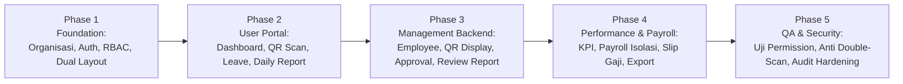

---

## 6. Role, Permission, dan Cakupan Data

### 6.1 Role aplikasi

| Role | Kode | Ringkasan wewenang |
|---|---|---|
| Staff | `staff` | Swalayan: profil, absensi, cuti, tugas, dan KPI milik sendiri |
| Department Manager | `dept_manager` | Melihat dan mengelola tim sendiri: absensi, persetujuan, tugas, KPI, laporan tim |
| Operations Manager | `ops_manager` | Seperti manager untuk timnya, ditambah pemantauan dan penugasan lintas departemen (K-07) |
| HR Admin | `hr_admin` | Data karyawan, administrasi absensi dan cuti, validasi HR, laporan HR, pengaturan kepegawaian |
| Finance Staff | `finance` | Data rekening/NPWP untuk penggajian, modul payroll (F3) |
| Management Viewer | `management` | Hanya lihat: ringkasan dan laporan lintas departemen |
| System Admin | `system_admin` | Akun, role, permission, konfigurasi, audit teknis. Tidak otomatis melihat data sensitif HR/payroll |

### 6.2 Cakupan data (data scope)

| Cakupan | Arti |
|---|---|
| `own` | Data milik pengguna sendiri |
| `team` | Karyawan yang (a) atasan langsungnya adalah pengguna, **atau** (b) berada di departemen yang managernya adalah pengguna |
| `all` | Seluruh karyawan, termasuk nonaktif (untuk histori dan laporan) |

Permission yang berakhiran `.own`, `.team`, atau `.all` membawa cakupannya sendiri. Permission tindakan (mis. `leave.approve`) hanya berlaku pada objek yang ada dalam cakupan pengguna **dan** tempat ia tercatat sebagai approver.

### 6.3 Permission swalayan

Diberikan otomatis ke **semua pengguna yang terhubung ke data karyawan**, apa pun role-nya:

| Permission | Arti | Fase |
|---|---|---|
| `employee.view.own` | Melihat profil sendiri | F1 |
| `employee.update.own` | Mengubah field terbatas di profil sendiri (FR-EMP-05) | F1 |
| `attendance.clock` | Clock-in dan clock-out | F1 |
| `attendance.view.own` | Melihat riwayat absensi sendiri | F1 |
| `attendance.correction.request` | Mengajukan koreksi absensi sendiri | F1 |
| `leave.request` | Mengajukan dan membatalkan cuti/izin sendiri | F1 |
| `leave.view.own` | Melihat pengajuan dan saldo cuti sendiri | F1 |
| `leave.calendar.view` | Melihat kalender cuti departemen sendiri (K-11) | F1 |
| `daily_report.submit` | Mengisi, menyimpan draf, dan submit Daily Report harian | Phase 2 |
| `daily_report.view.own` | Melihat riwayat Daily Report sendiri | Phase 2 |
| `kpi.view.own`, `kpi.update.own` | Melihat KPI sendiri; mengisi realisasi dan tanggapan | Phase 4 |
| `payroll.slip.view.own` | Melihat slip gaji sendiri | Phase 4 |

### 6.4 Matriks permission per role

Kolom: **MGR** Department Manager · **OPS** Operations Manager · **HR** HR Admin · **FIN** Finance Staff · **MGT** Management Viewer/Owner · **SA** System Admin.  
✔ = diberikan default · – = tidak · ◐ = diberikan per orang yang ditunjuk, bukan per role.

| Permission | Arti | MGR | OPS | HR | FIN | MGT | SA | Fase |
|---|---|:-:|:-:|:-:|:-:|:-:|:-:|:-:|
| **Akun & sistem** | | | | | | | | |
| `user.manage` | Membuat/menonaktifkan akun, reset password | – | – | ✔ | – | – | ✔ | Phase 1 |
| `rbac.manage` | Mengelola role dan permission | – | – | – | – | – | ✔ | Phase 1 |
| `settings.general.manage` | Pengaturan umum dan profil perusahaan | – | – | – | – | – | ✔ | Phase 1 |
| `settings.org.manage` | Departemen, jabatan, lokasi kerja | – | – | ✔ | – | – | ✔ | Phase 1 |
| `settings.attendance.manage` | Jadwal kerja, hari libur, dynamic QR screen | – | – | ✔ | – | – | ✔ | Phase 3 |
| `settings.leave.manage` | Jenis cuti dan kebijakan saldo | – | – | ✔ | – | – | ✔ | Phase 3 |
| `settings.approval.manage` | Alur approval dan approver cadangan | – | – | ✔ | – | – | ✔ | Phase 3 |
| `audit.view` | Melihat audit log | – | – | ✔ | – | – | ✔ | Phase 1 |
| **Karyawan** | | | | | | | | |
| `employee.view.team` | Melihat profil non-sensitif tim | ✔ | ✔ | ✔ | – | – | – | Phase 3 |
| `employee.view.all` | Melihat profil non-sensitif semua karyawan | – | ✔ | ✔ | ✔ | ✔ | ✔ | Phase 3 |
| `employee.sensitive.view` | Melihat KTP, BPJS, dokumen pribadi | – | – | ✔ | – | – | – | Phase 3 |
| `employee.bank.view` | Melihat rekening bank dan NPWP | – | – | ✔ | ✔ | – | – | Phase 3 |
| `employee.manage` | Tambah, ubah, mutasi, nonaktifkan, reaktivasi | – | – | ✔ | – | – | – | Phase 3 |
| `employee.document.manage` | Unggah/hapus dokumen karyawan | – | – | ✔ | – | – | – | Phase 3 |
| `employee.import_export` | Impor dan ekspor data karyawan | – | – | ✔ | – | – | – | Phase 3 |
| **Absensi (QR Code)** | | | | | | | | |
| `attendance.view.team` | Melihat absensi tim | ✔ | ✔ | ✔ | – | – | – | Phase 3 |
| `attendance.view.all` | Melihat absensi semua karyawan | – | ✔ | ✔ | – | ✔ | – | Phase 3 |
| `attendance.correction.approve` | Memutuskan koreksi absensi (sebagai approver) | ✔ | ✔ | ✔ | – | – | – | Phase 3 |
| `attendance.manage` | Input/ubah manual, kunci periode, generate QR | – | – | ✔ | – | – | – | Phase 3 |
| `attendance.export` | Ekspor rekap absensi sesuai cakupan lihat | ✔ | ✔ | ✔ | – | ✔ | – | Phase 3 |
| **Cuti & approval** | | | | | | | | |
| `leave.view.team` | Melihat pengajuan dan saldo cuti tim | ✔ | ✔ | ✔ | – | – | – | Phase 3 |
| `leave.view.all` | Melihat pengajuan dan saldo semua karyawan | – | – | ✔ | – | ✔ | – | Phase 3 |
| `leave.approve` | Memutuskan cuti/izin (tahap atasan) | ✔ | ✔ | ✔ | – | – | – | Phase 3 |
| `leave.validate` | Memutuskan cuti/izin (tahap HR) | – | – | ✔ | – | – | – | Phase 3 |
| `leave.manage` | Ajukan atas nama, batalkan setelah mulai, kelola saldo | – | – | ✔ | – | – | – | Phase 3 |
| `approval.delegate.own` | Menunjuk pengganti untuk approval sendiri | ✔ | ✔ | ✔ | – | – | – | Phase 3 |
| `approval.reassign` | Mengalihkan approver, mengatur delegasi orang lain | – | – | ✔ | – | – | – | Phase 3 |
| **Daily Report (Spreadsheet)** | | | | | | | | |
| `daily_report.view.team` | Melihat Daily Report tim sendiri | ✔ | ✔ | – | – | – | – | Phase 3 |
| `daily_report.view.all` | Melihat Daily Report lintas-departemen | – | ✔ | – | – | ✔ | – | Phase 3 |
| `daily_report.review_team` | Menyetujui (Accept) atau Minta Revisi (Request Revision) | ✔ | ✔ | – | – | – | – | Phase 3 |
| `daily_report.template.manage` | Mengelola template kolom tambahan per departemen | – | – | ✔ | – | – | ✔ | Phase 3 |
| `daily_report.export` | Ekspor rekap Daily Report ke Excel | ✔ | ✔ | ✔ | – | ✔ | – | Phase 3 |
| **KPI** | | | | | | | | |
| `kpi.view.team` | Melihat KPI tim | ✔ | ✔ | – | – | – | – | Phase 4 |
| `kpi.view.all` | Melihat rekap KPI semua karyawan | – | – | ✔ | – | ✔ | – | Phase 4 |
| `kpi.target.set` | Menetapkan target KPI tim | ✔ | ✔ | – | – | – | – | Phase 4 |
| `kpi.review` | Menilai dan memberi catatan KPI tim | ✔ | ✔ | – | – | – | – | Phase 4 |
| `kpi.manage` | Periode, template, grade, penutupan periode | – | – | ✔ | – | – | – | Phase 4 |
| **Laporan** | | | | | | | | |
| `report.export` | Ekspor laporan sesuai cakupan lihat tiap modul | ✔ | ✔ | ✔ | ✔ | ✔ | – | F1 |
| **Payroll** | | | | | | | | |
| `payroll.manage` | Komponen gaji, perhitungan, penerbitan slip | – | – | ✔ | ✔ | – | – | F3 |
| `payroll.approve` | Menyetujui payroll sebelum final | ◐ | ◐ | ◐ | ◐ | ◐ | – | F3 |
| `payroll.report.view` | Melihat laporan payroll | – | – | ✔ | ✔ | ✔ | – | F3 |
| **Rekrutmen & checklist** | | | | | | | | |
| `recruitment.view` | Melihat kandidat departemen sendiri, mengisi penilaian | ✔ | – | ✔ | – | ✔ | – | F3 |
| `recruitment.manage` | Lowongan, kandidat, pipeline | – | – | ✔ | – | – | – | F3 |
| `checklist.manage` | Template dan pelaksanaan on/offboarding | – | – | ✔ | – | – | – | F3 |

Catatan matriks:
- Kepala HR memegang dua role (HR Admin + Department Manager) sehingga memperoleh gabungan kolom HR dan MGR.
- Halaman Laporan menampilkan laporan sesuai permission lihat tiap modul; `report.export` hanya mengatur boleh/tidaknya ekspor.
- System Admin boleh melihat direktori karyawan (non-sensitif) untuk menautkan akun, tetapi tidak melihat absensi, cuti, KPI, atau payroll.

### 6.5 Aturan penegakan (wajib)

1. **Backend memeriksa izin di setiap request** (Policy/Gate). Menyembunyikan menu di tampilan bukan pengaman.
2. Semua query daftar melewati satu mekanisme cakupan (mis. scope `visibleTo($user)`), bukan filter di tampilan.
3. Akses objek lewat ID di URL diperiksa policy; di luar cakupan → HTTP 403 (mencegah IDOR).
4. Field sensitif ditampilkan ter-*mask* (mis. `************1234`) kecuali pengguna punya permission; setiap kali field dibuka, akses dicatat di audit log.
5. Tidak ada yang boleh memutuskan pengajuan miliknya sendiri, walaupun punya permission approve.
6. Role ganda menghasilkan gabungan permission. Tidak ada permission "larangan".
7. Perubahan role/permission berlaku pada request berikutnya (cache permission dibersihkan).
8. Semua tindakan System Admin dan semua perubahan role/permission tercatat di audit log.
9. Setiap rute punya uji otomatis "role yang boleh" dan "role yang ditolak" (lihat bagian 12).

---

## 7. Spesifikasi Modul

### 7.0 Peta alur utama

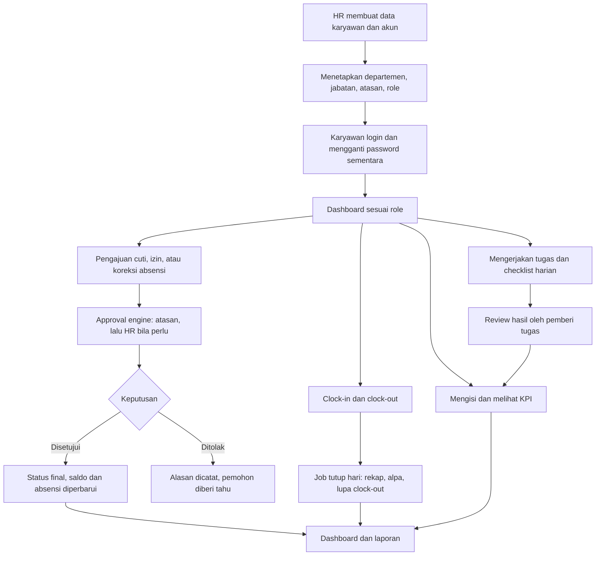

Setiap modul di bawah memakai susunan yang sama: tujuan → requirement (FR) → aturan bisnis (BR) → alur/status → validasi dan kasus tepi → acceptance criteria (AC). Event notifikasi dikumpulkan di M11.

---

### M01 — Autentikasi & Akun (F1)

**Tujuan.** Memastikan hanya karyawan aktif yang bisa masuk, dengan akun yang dibuat dan dikendalikan perusahaan.  
**Aktor.** Semua pengguna; HR Admin dan System Admin sebagai pengelola akun.  
**Halaman.** P-01, P-02, P-07.

| ID | Requirement | Prioritas |
|---|---|:-:|
| FR-AUTH-01 | Login dengan email dan password; sesi berbasis cookie | W |
| FR-AUTH-02 | Tidak ada pendaftaran mandiri. Akun dibuat HR Admin/System Admin, biasanya bersamaan dengan data karyawan (FR-EMP-01) | W |
| FR-AUTH-03 | Akun baru memakai password sementara; pengguna **wajib mengganti** saat login pertama sebelum bisa membuka halaman lain | W |
| FR-AUTH-04 | Kebijakan password: minimal 8 karakter, mengandung huruf dan angka, tidak sama dengan email; disimpan ter-*hash* | W |
| FR-AUTH-05 | Pembatasan percobaan: 5 kali gagal untuk kombinasi email + IP → terkunci 15 menit | W |
| FR-AUTH-06 | Lupa password: tautan reset lewat email (berlaku 60 menit, sekali pakai). Jika email belum dikonfigurasi, HR Admin/System Admin melakukan reset manual yang menghasilkan password sementara | W |
| FR-AUTH-07 | Ganti password dari halaman Profil Saya (wajib memasukkan password lama) | W |
| FR-AUTH-08 | Sesi berakhir otomatis setelah 120 menit tidak aktif (bisa dikonfigurasi). Opsi "Ingat saya" memperpanjang hingga 30 hari | S |
| FR-AUTH-09 | Akun nonaktif tidak bisa login; saat akun dinonaktifkan, semua sesi aktifnya langsung dicabut | W |
| FR-AUTH-10 | Sistem mencatat waktu dan IP login terakhir, serta login gagal, ke audit log | W |
| FR-AUTH-11 | Logout dari perangkat ini; "keluar dari semua perangkat" di Profil Saya | O |

**Aturan bisnis**
- BR-AUTH-01 — Email akun unik dan tidak peka huruf besar/kecil.
- BR-AUTH-02 — Pesan gagal login selalu sama ("Email atau password salah") agar tidak membocorkan email mana yang terdaftar.
- BR-AUTH-03 — Halaman lupa password selalu menampilkan pesan sukses yang sama, terdaftar atau tidak.
- BR-AUTH-04 — Reset manual oleh admin memaksa ganti password pada login berikutnya dan tercatat di audit log (tanpa menyimpan password).
- BR-AUTH-05 — Satu karyawan hanya punya satu akun; akun tanpa data karyawan hanya untuk System Admin dan Management Viewer.

**Kasus tepi**
- Pengguna menutup browser saat wajib ganti password → pada login berikutnya tetap diarahkan ke halaman ganti password.
- Tautan reset dipakai dua kali atau kedaluwarsa → tampilkan pesan dan tombol minta tautan baru.
- Role pengguna diubah saat ia sedang login → menu dan izin menyesuaikan pada request berikutnya.

**Acceptance criteria**
- [ ] AC-AUTH-01 — Akun baru tidak bisa membuka halaman apa pun sebelum mengganti password sementara.
- [ ] AC-AUTH-02 — Percobaan login ke-6 dalam 15 menit ditolak dengan pesan tunggu, walaupun password benar.
- [ ] AC-AUTH-03 — Akun yang dinonaktifkan saat sedang login langsung ter-logout pada request berikutnya.
- [ ] AC-AUTH-04 — Password tidak pernah muncul di log, audit log, atau email (kecuali password sementara yang ditampilkan sekali ke admin).
- [ ] AC-AUTH-05 — Semua halaman selain login/lupa password mengarahkan ke login bila sesi tidak ada.

---

### M02 — Organisasi (F1)

**Tujuan.** Menyediakan data master departemen, jabatan, dan lokasi kerja yang dipakai semua modul.  
**Aktor.** HR Admin, System Admin.  
**Halaman.** P-22 (Pengaturan → Organisasi).

| ID | Requirement | Prioritas |
|---|---|:-:|
| FR-ORG-01 | Kelola departemen: kode unik, nama, manager, status aktif | W |
| FR-ORG-02 | Kelola jabatan per departemen: nama, level (`staff` / `manager` / `head`), role aplikasi default | W |
| FR-ORG-03 | Kelola lokasi kerja: nama, zona waktu (format IANA, mis. `Asia/Jakarta`), daftar IP kantor (opsional) | W |
| FR-ORG-04 | Data master yang sudah dipakai tidak dihapus, hanya dinonaktifkan | W |
| FR-ORG-05 | Data awal (seeder) berisi struktur pada bagian 3.1 | W |
| FR-ORG-06 | Bagan organisasi sederhana: departemen → manager → anggota | S |

**Aturan bisnis**
- BR-ORG-01 — Departemen tidak bisa dinonaktifkan selama masih punya karyawan aktif.
- BR-ORG-02 — Manager departemen harus karyawan aktif. Jika ia dinonaktifkan atau dimutasi, kolom manager dikosongkan, HR diberi notifikasi, dan approval tim jatuh ke approver cadangan sampai manager baru ditetapkan.
- BR-ORG-03 — Mengubah nama departemen/jabatan tidak mengubah histori penempatan, karena histori merujuk ID.
- BR-ORG-04 — Lokasi kerja default: "Kantor Bandar Lampung" dengan zona waktu `Asia/Jakarta`.

**Acceptance criteria**
- [ ] AC-ORG-01 — Empat departemen dan seluruh jabatan pada bagian 3.1 tersedia setelah instalasi awal.
- [ ] AC-ORG-02 — Menonaktifkan departemen yang masih punya karyawan aktif ditolak dengan pesan yang menyebut jumlah karyawannya.
- [ ] AC-ORG-03 — Departemen/jabatan nonaktif tidak muncul di pilihan form baru, tetapi tetap tampil di histori.

---

### M03 — Employee Management (F1)

**Tujuan.** Satu sumber data karyawan yang lengkap, punya histori, dan aman.  
**Aktor.** HR Admin (pengelola), Manager (melihat tim), semua karyawan (profil sendiri).  
**Halaman.** P-04, P-05, P-06, P-07.

#### Data karyawan

| Kelompok | Field | Wajib | Yang boleh mengubah | Terlihat oleh |
|---|---|:-:|---|---|
| Identitas | Nomor karyawan (otomatis), nama lengkap, nama panggilan, jenis kelamin, foto | Nama lengkap | HR; foto oleh karyawan | Semua (direktori) |
| Identitas | Tempat dan tanggal lahir | – | HR | Diri sendiri, HR |
| Kontak | Email kerja (untuk login) | Ya | HR | Semua (direktori) |
| Kontak | Nomor HP/WhatsApp, kontak darurat (nama, hubungan, nomor) | Nomor HP | Karyawan, HR | Diri sendiri, atasan, HR |
| Kontak | Alamat domisili, email pribadi | – | Karyawan, HR | Diri sendiri, HR |
| Kepegawaian | Tanggal bergabung, status kerja, tanggal akhir kontrak/percobaan | Ya | HR | Diri sendiri, atasan, HR |
| Kepegawaian | Departemen, jabatan, atasan langsung (lewat penempatan) | Ya | HR | Semua (direktori) |
| Kepegawaian | Lokasi kerja, jadwal kerja | Ya | HR | Diri sendiri, atasan, HR |
| Sensitif | Nomor KTP, BPJS Kesehatan, BPJS Ketenagakerjaan | – | HR | `employee.sensitive.view` |
| Sensitif | Bank, nomor rekening, nama pemilik rekening, NPWP | – | HR | `employee.bank.view` |
| Dokumen | KTP, KK, ijazah, kontrak, sertifikat, lainnya | – | HR | Diri sendiri (lihat), `employee.sensitive.view` |
| Status | Aktif/nonaktif, tanggal keluar, alasan keluar, catatan | – | HR | Diri sendiri, atasan, HR |

#### Functional requirements

| ID | Requirement | Prioritas |
|---|---|:-:|
| FR-EMP-01 | Tambah karyawan lewat form bertahap: data pribadi → kepegawaian → akun dan role. Akun login dibuat pada langkah terakhir (M01) | W |
| FR-EMP-02 | Nomor karyawan dibuat otomatis dengan format yang bisa diatur (default `KG-{YY}{NNN}`, contoh `KG-26001`) dan tidak pernah berubah | W |
| FR-EMP-03 | Daftar karyawan: cari nama/nomor/email; filter departemen, jabatan, status kerja, aktif/nonaktif; urutkan; 25 baris per halaman | W |
| FR-EMP-04 | Detail profil bertab: Ringkasan, Kepegawaian & Histori, Dokumen, Absensi, Cuti. Tab Tugas dan KPI ditambah di F2 | W |
| FR-EMP-05 | Karyawan mengubah sendiri: foto, nomor HP, alamat, email pribadi, kontak darurat. Field lain hanya HR | W |
| FR-EMP-06 | Mutasi, promosi, demosi, atau ganti atasan dilakukan dengan membuat **penempatan baru** bertanggal efektif (boleh tanggal mendatang). Penempatan lama ditutup otomatis sehari sebelumnya | W |
| FR-EMP-07 | Menonaktifkan karyawan: tanggal keluar, alasan (resign, kontrak berakhir, PHK, lainnya), catatan. Bila tanggal keluar mendatang, penonaktifan berjalan otomatis pada tanggal itu | W |
| FR-EMP-08 | Saat karyawan menjadi nonaktif: akun dimatikan dan sesi dicabut; pengajuan miliknya yang masih menunggu dibatalkan sistem; approval yang menunggu keputusannya dialihkan (FR-APR-07); tugas aktifnya ditandai perlu dialihkan (F2) | W |
| FR-EMP-09 | Reaktivasi: mengaktifkan kembali karyawan lama dengan penempatan baru; nomor karyawan tetap | S |
| FR-EMP-10 | Dokumen karyawan: unggah PDF/JPG/PNG maksimal 5 MB per file, berkategori, tersimpan privat | W |
| FR-EMP-11 | Data sensitif dienkripsi di database, tampil ter-*mask*, dibuka dengan permission, dan setiap pembukaan dicatat | W |
| FR-EMP-12 | Impor massal dari Excel dengan template: validasi per baris, mode pratinjau tanpa menyimpan, laporan error yang bisa diunduh | W |
| FR-EMP-13 | Ekspor daftar karyawan ke Excel; kolom sensitif hanya ikut bila pengguna punya permission-nya | S |
| FR-EMP-14 | Pengingat ke HR saat kontrak/masa percobaan berakhir pada H-30 dan H-7 | S |
| FR-EMP-15 | Histori perubahan per karyawan (siapa, kapan, nilai lama → baru) tampil di tab Kepegawaian & Histori | W |

#### Aturan bisnis

- BR-EMP-01 — Satu karyawan hanya punya satu penempatan aktif pada satu tanggal; rentang tanggal penempatan tidak boleh tumpang-tindih.
- BR-EMP-02 — Email kerja dan nomor karyawan unik.
- BR-EMP-03 — Tidak ada hapus permanen. Hapus (soft delete) hanya untuk salah input, oleh HR, dan hanya bila karyawan belum punya transaksi apa pun.
- BR-EMP-04 — Atasan langsung harus karyawan aktif, bukan diri sendiri, dan tidak boleh membentuk lingkaran (A atasan B sekaligus B atasan A).
- BR-EMP-05 — Tanggal keluar tidak boleh sebelum tanggal bergabung.
- BR-EMP-06 — Status kerja: `probation`, `contract`, `permanent`, `intern`. Status selain `permanent` wajib punya tanggal akhir.
- BR-EMP-07 — Penempatan bertanggal mendatang baru memengaruhi cakupan tim dan approver pada tanggal efektifnya.
- BR-EMP-08 — Perubahan departemen/jabatan/atasan tidak pernah menimpa data lama; selalu menjadi baris histori baru.
- BR-EMP-09 — Semua perubahan field kepegawaian dan sensitif mencatat pelaku, waktu, nilai lama, dan nilai baru (nilai sensitif di audit log disimpan ter-*mask*).

#### Status karyawan

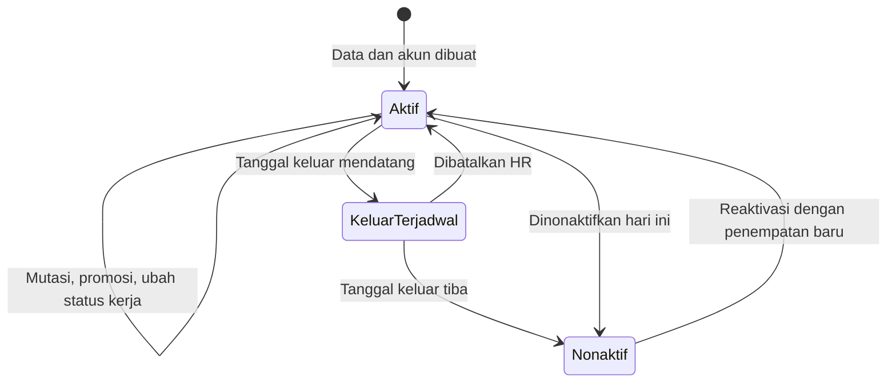

#### Validasi dan kasus tepi

- Email sudah dipakai → tolak dan tunjukkan karyawan pemilik email (bila pengguna berhak melihatnya).
- Impor: baris bermasalah tidak menggagalkan baris lain; hasil menampilkan jumlah berhasil, gagal, dan alasan per baris. Kolom departemen/jabatan dicocokkan dengan kode, bukan nama bebas.
- Mutasi karyawan yang menjadi manager departemen → sistem meminta HR memilih manager pengganti atau membiarkan kosong (BR-ORG-02).
- Menonaktifkan karyawan yang masih menjadi atasan orang lain → sistem menampilkan daftar bawahannya dan meminta atasan pengganti.
- File dokumen dengan ekstensi/MIME tidak sesuai atau melebihi ukuran → ditolak sebelum disimpan.

#### Acceptance criteria

- [ ] AC-EMP-01 — HR dapat menambah karyawan sampai akunnya bisa login dalam satu alur tanpa berpindah menu.
- [ ] AC-EMP-02 — Setelah mutasi, tab Histori menampilkan penempatan lama dan baru lengkap dengan tanggal efektif; data absensi dan cuti lama tidak berubah.
- [ ] AC-EMP-03 — Manager hanya melihat karyawan dalam cakupan timnya; membuka URL profil karyawan lain menghasilkan 403.
- [ ] AC-EMP-04 — Staff tidak bisa mengubah field kepegawaian miliknya, baik lewat form maupun request langsung.
- [ ] AC-EMP-05 — Nomor KTP dan rekening tersimpan terenkripsi (tidak terbaca di database) dan tampil ter-*mask* bagi yang tidak berhak.
- [ ] AC-EMP-06 — Karyawan nonaktif tidak bisa login, tetapi tetap muncul di laporan periode saat ia masih aktif.
- [ ] AC-EMP-07 — Impor 100 baris dengan 5 baris salah menghasilkan 95 karyawan baru dan laporan 5 error yang menyebut nomor baris dan penyebabnya.
- [ ] AC-EMP-08 — Dokumen karyawan tidak bisa dibuka lewat URL langsung tanpa login dan permission.

---

### M04 — Attendance (F1)

**Tujuan.** Mencatat kehadiran harian secara konsisten, menghasilkan rekap yang bisa dipercaya, dan menyediakan jalur koreksi yang terlacak.  
**Aktor.** Semua karyawan (absen), atasan (pantau dan putuskan koreksi), HR Admin (kelola dan rekap).  
**Halaman.** P-08, P-09, P-10, P-22 (Jadwal & Libur).

#### Status harian

| Kode | Label | Ditetapkan ketika |
|---|---|---|
| `present` | Hadir | Clock-in tidak melewati jam masuk + toleransi |
| `late` | Terlambat | Clock-in melewati jam masuk + toleransi |
| `leave` | Cuti | Ada cuti disetujui pada tanggal itu |
| `sick` | Sakit | Ada izin sakit disetujui pada tanggal itu |
| `permit` | Izin | Ada izin disetujui pada tanggal itu |
| `absent` | Alpa | Hari kerja tanpa clock-in dan tanpa cuti/izin disetujui |

Penanda tambahan (bukan status): **lupa clock-out** (`is_incomplete`), **pulang cepat** (`early_leave_minutes` > 0), **masuk di hari libur** (`is_off_day`).

#### Functional requirements

| ID | Requirement | Prioritas |
|---|---|:-:|
| FR-ATT-01 | **Absen Pagi & Absen Sore via Dynamic QR Code:** Sistem membedakan secara eksplisit **Absen Pagi (Jam Masuk)** dan **Absen Sore (Jam Pulang)**. Karyawan membuka scanner kamera di User Portal, memilih atau secara otomatis memindai QR kantor. Waktu diverifikasi dari **server**; sistem mencatat waktu server WIB, lokasi, dan IP | W |
| FR-ATT-02 | **Aturan Absen Pagi:** Jam kerja kantor 08:00 - 09:00 WIB. Absen setelah pukul 09:00 WIB otomatis berstatus Terlambat (`late`). Jika karyawan sudah absen pagi, sistem menampilkan jam masuk dan memblokir scan ulang absen pagi | W |
| FR-ATT-03 | **Aturan Absen Sore:** Jam pulang kantor mulai pukul 17:00 WIB. Absen sore mencatat jam kepulangan (`time_out`), status kepulangan cepat jika < 17:00 WIB, dan otomatis menghitung total durasi kerja harian | W |
| FR-ATT-04 | **Antarmuka User Portal Dual Cards:** Halaman Kehadiran Saya (P-08) menyajikan kartu interaktif terpisah untuk **Absen Pagi (Masuk)** dan **Absen Sore (Pulang)**, lengkap dengan jam realtime kantor WIB, badge status, dan tombol scan dedicated | W |
| FR-ATT-05 | *Job tutup hari* (berjalan setelah tengah malam) membuat status Alpa bagi karyawan aktif yang tidak melakukan absen pagi dan tidak punya perizinan kerja disetujui | W |
| FR-ATT-06 | Job tutup hari menandai record yang punya Absen Pagi tanpa Absen Sore sebagai **lupa absen sore / clock-out**; durasi kerja kosong sampai dikoreksi | W |
| FR-ATT-07 | Koreksi absensi: karyawan memilih tanggal, mengisi usulan jam Absen Pagi dan jam Absen Sore, serta alasan koreksi. Diputuskan oleh atasan / HR (M06) | W |
| FR-ATT-08 | Koreksi yang disetujui memperbarui jam absen pagi/sore record, menghitung ulang status, dan menyimpan nilai sebelum–sesudah di audit log | W |
| FR-ATT-09 | Sinkron dengan perizinan: tanggal yang memiliki perizinan disetujui (sakit, acara keluarga, dll) otomatis berstatus Izin/Sakit, dan absen pagi diblokir | W |
| FR-ATT-10 | Kunci periode: HR mengunci rekap bulanan sebelum penggajian; perubahan setelah kunci membutuhkan pembukaan khusus | W |
| FR-ATT-11 | HR dapat menambah atau mengubah record secara manual dengan alasan wajib dan tercatat di audit log | W |
| FR-ATT-12 | Riwayat pribadi: tabel riwayat menampilkan kolom terpisah **Absen Pagi (Masuk)**, **Absen Sore (Pulang)**, status harian, dan durasi kerja | W |
| FR-ATT-13 | Absensi tim/semua: monitoring harian Admin Attendance (P-09) menampilkan log Absen Pagi & Sore seluruh karyawan secara realtime | W |
| FR-ATT-14 | Ekspor rekap harian, mingguan, dan bulanan ke Excel dan PDF | W |
| FR-ATT-15 | Jadwal kerja: jam masuk (08:00), batas toleransi masuk (09:00), jam pulang (17:00) | W |
| FR-ATT-16 | Hari libur nasional dan cuti bersama | W |
| FR-ATT-17 | **Dynamic QR Generator (Admin Display):** Halaman Management Backend & Terminal Layar Penuh (TV) untuk menampilkan QR Code dinamis yang berotasi otomatis setiap 45–60 detik di kantor untuk melayani Absen Pagi dan Sore | W |
| FR-ATT-18 | **Validasi Keamanan QR Server:** Backend memverifikasi token rahasia berotasi, menolak token kedaluwarsa atau token palsu browser, dan memblokir scan ganda (double submission) | W |

#### Aturan bisnis

- BR-ATT-01 — Satu record Absen Pagi dan satu record Absen Sore per karyawan per tanggal kerja.
- BR-ATT-02 — Tanggal kerja ditentukan dari waktu lokal **lokasi kerja karyawan** saat scan (WIB), bukan zona waktu browser.
- BR-ATT-03 — Semua waktu absensi disimpan dalam UTC dan ditampilkan dalam zona waktu lokal karyawan.
- BR-ATT-04 — Validasi QR Code dilakukan 100% di server; browser tidak boleh menentukan status atau waktu scan.
- BR-ATT-05 — Token QR Code memiliki masa berlaku singkat (rolling window) untuk mencegah QR difoto dan disebarkan ke luar kantor.
- BR-ATT-06 — Tanggal yang punya cuti/izin disetujui tidak bisa di-clock-in.
- BR-ATT-07 — Koreksi absensi hanya bisa diajukan maksimal 7 hari setelah tanggal kerja dan tidak berlaku pada periode yang sudah terkunci.

#### Alur

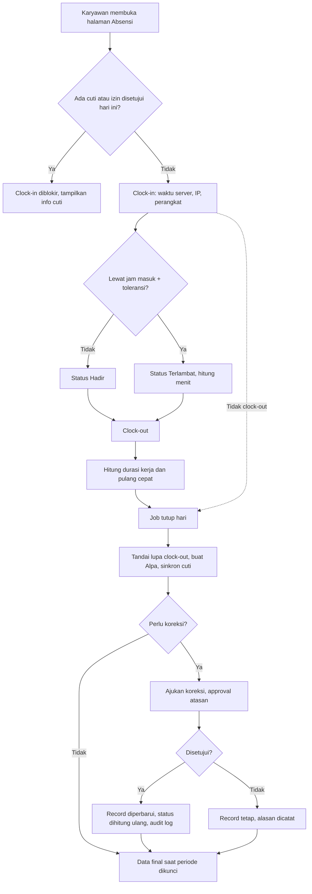

Status pengajuan koreksi: `pending` (Menunggu) → `approved` (Disetujui) / `rejected` (Ditolak) / `cancelled` (Dibatalkan pemohon atau sistem).

#### Kasus tepi

| Situasi | Perilaku sistem |
|---|---|
| Tombol clock-in ditekan dua kali atau dari dua perangkat | Hanya yang pertama tersimpan; yang kedua menampilkan record yang sudah ada |
| Jaringan putus saat clock-in | Tampil pesan gagal; tidak ada penyimpanan offline. Karyawan mengulang atau mengajukan koreksi |
| Lupa absen sama sekali (sudah menjadi Alpa) | Boleh mengajukan koreksi; bila disetujui record berubah dari Alpa |
| Cuti/izin disetujui setelah record Alpa terlanjur dibuat (mis. sakit yang diajukan mundur) | Record otomatis berubah ke status cuti/sakit/izin dan tercatat di audit log |
| Karyawan pindah lokasi kerja beda zona waktu | Tanggal kerja mengikuti lokasi kerja yang berlaku pada hari itu |
| Jam kerja melewati tengah malam (shift malam) | Tidak didukung di versi ini |
| Hari libur ditambahkan setelah Alpa terlanjur dibuat untuk tanggal itu | Record Alpa pada tanggal tersebut dihapus otomatis saat hari libur disimpan |

#### Acceptance criteria

- [ ] AC-ATT-01 — Dengan jam masuk 08.00 dan toleransi 10 menit: clock-in 08.10 → Hadir; clock-in 08.11 → Terlambat 11 menit.
- [ ] AC-ATT-02 — Menekan clock-in dua kali atau dari dua perangkat menghasilkan satu record.
- [ ] AC-ATT-03 — Mengubah jam di perangkat tidak mengubah waktu yang tercatat.
- [ ] AC-ATT-04 — Karyawan aktif tanpa clock-in pada hari kerja menjadi Alpa keesokan harinya; pada hari libur tidak dibuat Alpa.
- [ ] AC-ATT-05 — Clock-in tanpa clock-out ditandai lupa clock-out dan karyawan menerima notifikasi.
- [ ] AC-ATT-06 — Koreksi disetujui mengubah record dan audit log menyimpan nilai sebelum dan sesudah; koreksi ditolak tidak mengubah record.
- [ ] AC-ATT-07 — Setelah periode dikunci, pengajuan koreksi dan ubah manual untuk bulan itu ditolak.
- [ ] AC-ATT-08 — Karyawan di lokasi kerja UTC+8 yang clock-in pukul 00.30 waktu setempat tercatat pada tanggal lokalnya, bukan tanggal server.
- [ ] AC-ATT-09 — Angka rekap bulanan satu karyawan sama dengan penjumlahan manual record hariannya.
- [ ] AC-ATT-10 — Manager hanya melihat absensi timnya; staff hanya miliknya.

---

### M05 — Permission & Leave Management (Perizinan Kerja) (F1)

**Tujuan.** Pengajuan perizinan kerja tidak masuk (izin sakit, ada acara, keperluan keluarga, atau keperluan mendesak) yang tervalidasi otomatis dan terlacak keputusannya oleh atasan. **Kurma Group tidak menerapkan sistem kuota cuti tahunan (No Annual Leave Balance); seluruh ketidakhadiran yang sah diproses melalui pengajuan perizinan kerja.**  
**Aktor.** Semua karyawan (mengajukan), atasan (meninjau & menyetujui), HR Admin (monitoring & administrasi).  
**Halaman.** P-11 (Pengajuan Izin Saya), P-12 (Persetujuan Izin).

#### Jenis perizinan resmi

| Kode | Nama | Lampiran Wajib | Persetujuan | Status Absensi | Keterangan |
|---|---|:-:|:-:|---|---|
| `SICK` | Izin Sakit | Opsional (Wajib jika > 1 hari / surat dokter) | Atasan Langsung | Sakit | Karyawan berhalangan karena kondisi kesehatan |
| `EVENT` | Izin Ada Acara | Opsional (Surat undangan / bukti acara jika ada) | Atasan Langsung | Izin | Menghadiri acara penting, pernikahan, dll |
| `FAMILY` | Izin Keperluan Keluarga | Opsional | Atasan Langsung | Izin | Urusan keluarga mendesak / duka cita |
| `URGENT` | Izin Mendesak / Darurat | Opsional | Atasan Langsung | Izin | Keadaan mendesak tiba-tiba |
| `OTHER` | Izin Lainnya | Opsional | Atasan Langsung | Izin | Keperluan lain dengan alasan tertulis |

#### Functional requirements

| ID | Requirement | Prioritas |
|---|---|:-:|
| FR-LEV-01 | Form pengajuan izin: jenis perizinan, tanggal mulai, tanggal selesai, alasan (wajib), lampiran surat/bukti (opsional) | W |
| FR-LEV-02 | Jumlah hari izin dihitung otomatis dari rentang tanggal pengajuan | W |
| FR-LEV-03 | Validasi saat kirim: tanggal sah, tanggal selesai ≥ tanggal mulai, alasan terisi | W |
| FR-LEV-04 | Persetujuan oleh atasan langsung: Setujui (Approved) atau Tolak (Rejected) disertai catatan | W |
| FR-LEV-05 | Halaman Pengajuan Izin Saya: kartu statistik perizinan (total tiket, sakit, acara/keperluan) dan riwayat pengajuan beserta status | W |
| FR-LEV-06 | Pembatalan oleh pemohon selama pengajuan masih berstatus pending | W |
| FR-LEV-07 | Penolakan oleh atasan dapat disertai alasan yang terlihat oleh pemohon | W |
| FR-LEV-08 | Saat izin disetujui, record absensi pada tanggal terkait tercatat sesuai status izin (Sakit / Izin) | W |
| FR-LEV-09 | Manager melihat pengajuan izin timnya; HR dapat melihat seluruh perizinan perusahaan | W |

#### Aturan bisnis

- BR-LEV-01 — **Tidak ada saldo/kuota cuti tahunan.** Tidak ada potongan saldo cuti 12 hari per tahun. Pengajuan dievaluasi murni berdasarkan kelayakan alasan dan persetujuan atasan.
- BR-LEV-02 — Pengajuan izin yang tumpang tindih pada tanggal yang sama untuk karyawan yang sama ditolak sistem.
- BR-LEV-03 — Izin sakit lebih dari 1 hari dianjurkan mengunggah lampiran surat keterangan dokter.
- BR-LEV-04 — Pengajuan tidak bisa diubah setelah dikirim; pemohon dapat membatalkan lalu mengajukan ulang jika diperlukan perbaikan.
- BR-LEV-08 — Karyawan berstatus keluar terjadwal tidak bisa mengajukan cuti melewati tanggal keluarnya.
- BR-LEV-09 — Lampiran pengajuan (mis. surat dokter) hanya bisa dibuka oleh pemohon, approver pada pengajuan itu, dan HR.

#### Status pengajuan

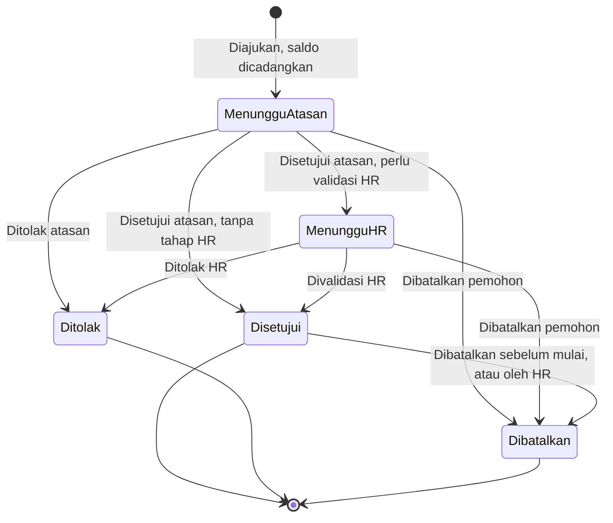

Di database, status pengajuan disimpan sebagai `pending`, `approved`, `rejected`, `cancelled`; tahap "menunggu atasan" atau "menunggu HR" dibaca dari langkah approval yang sedang aktif.

#### Kasus tepi

| Situasi | Perilaku sistem |
|---|---|
| Atasan pemohon sedang cuti | Jatuh ke pengganti yang ditunjuk (delegasi); bila tidak ada, HR mengalihkan |
| Karyawan belum berhak cuti tahunan | Jenis Cuti Tahunan tampil dengan sisa 0 dan keterangan tanggal mulai berhak |
| Sakit diajukan mundur setelah Alpa tercatat | Saat disetujui, record Alpa berubah menjadi Sakit |
| Dua petugas HR memutuskan bersamaan | Keputusan pertama yang berlaku; yang kedua mendapat pesan "sudah diputuskan" |
| Pemohon dimutasi saat pengajuan masih menunggu | Langkah yang masih menunggu dialihkan ke atasan baru (FR-APR-07) |
| Cuti yang sudah lewat perlu dibatalkan | Hanya HR, lewat FR-LEV-09 |

#### Acceptance criteria

- [ ] AC-LEV-01 — Dengan jadwal Senin–Jumat, pengajuan Senin–Jumat yang memuat satu hari libur nasional terhitung 4 hari.
- [ ] AC-LEV-02 — Pengajuan yang melebihi sisa saldo ditolak saat dikirim dengan pesan yang menyebut sisa saldo.
- [ ] AC-LEV-03 — Saldo dicadangkan saat diajukan, menjadi terpakai saat disetujui, dan kembali saat ditolak/dibatalkan; sisa saldo selalu sesuai rumus BR-LEV-01.
- [ ] AC-LEV-04 — Pengajuan yang bentrok tanggal dengan pengajuan aktif lain ditolak.
- [ ] AC-LEV-05 — Cuti Tahunan melewati dua tahap dan Izin satu tahap (default K-01); mengubah pengaturan jenis cuti mengubah alur pengajuan berikutnya.
- [ ] AC-LEV-06 — Penolakan tanpa alasan tidak bisa disimpan.
- [ ] AC-LEV-07 — Setelah cuti disetujui, tanggal terkait di absensi berstatus Cuti dan clock-in diblokir.
- [ ] AC-LEV-08 — Staff melihat kalender cuti departemennya tanpa jenis dan alasan, dan tidak melihat departemen lain.
- [ ] AC-LEV-09 — Lampiran surat dokter tidak bisa dibuka pengguna di luar pemohon, approver terkait, dan HR.
- [ ] AC-LEV-10 — Pengajuan yang ditolak atau dibatalkan tetap tersimpan dan tampil di riwayat.

---

### M06 — Approval Engine (F1)

**Tujuan.** Satu mekanisme persetujuan yang dipakai semua jenis pengajuan, sehingga aturan approver, delegasi, dan histori tidak ditulis ulang di tiap modul.  
**Dipakai oleh.** Cuti/izin (M05), koreksi absensi (M04), payroll (M13, F3).  
**Halaman.** P-12, P-13, P-22 (Approval).

#### Functional requirements

| ID | Requirement | Prioritas |
|---|---|:-:|
| FR-APR-01 | Satu mekanisme approval untuk semua jenis pengajuan | W |
| FR-APR-02 | Tiap pengajuan punya satu atau beberapa langkah berurutan. Langkah berikutnya baru aktif setelah langkah sebelumnya disetujui; satu penolakan mengakhiri pengajuan | W |
| FR-APR-03 | Approver tiap langkah ditentukan otomatis saat pengajuan dibuat (lihat aturan resolusi) | W |
| FR-APR-04 | Keputusan: **Setujui** (catatan opsional) atau **Tolak** (alasan wajib). Sistem mencatat pemutus, waktu, dan catatan | W |
| FR-APR-05 | Kotak masuk Persetujuan: daftar yang menunggu keputusan saya (filter jenis, urut dari yang terlama) dan riwayat keputusan saya | W |
| FR-APR-06 | Delegasi: approver menunjuk pengganti untuk rentang tanggal. Selama masa itu, pengajuan baru dan yang masih menunggu muncul di kotak masuk pengganti; keputusan dicatat "atas nama" | W |
| FR-APR-07 | Pengalihan: HR dapat mengalihkan langkah yang masih menunggu ke approver lain dengan alasan. Sistem mengalihkan otomatis saat approver nonaktif/dimutasi atau saat pemohon berganti atasan | W |
| FR-APR-08 | Linimasa pada tiap pengajuan: urutan langkah, status, pemutus, waktu, catatan, serta pengalihan/delegasi yang terjadi | W |
| FR-APR-09 | Alur default tiap jenis pengajuan tersedia sejak instalasi; tahap HR untuk cuti diatur per jenis cuti | W |
| FR-APR-10 | Pengingat dan eskalasi untuk langkah yang terlalu lama menunggu (ambang sama dengan FR-LEV-13) | S |
| FR-APR-11 | Setujui massal untuk beberapa pengajuan sekaligus (hanya menyetujui) | O |
| FR-APR-12 | Editor alur approval kustom (menambah langkah atau approver tertentu) | O |

#### Aturan resolusi approver

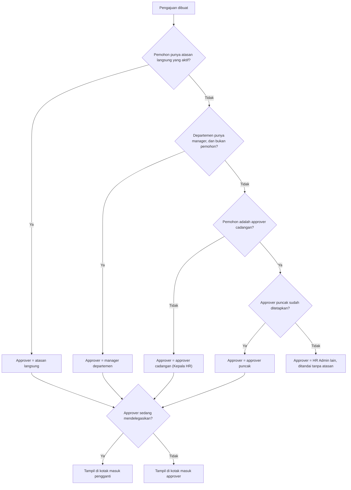

#### Aturan bisnis

- BR-APR-01 — Langkah **atasan langsung** mengikuti urutan pada diagram di atas. Approver cadangan dan approver puncak ditetapkan di Pengaturan (K-02).
- BR-APR-02 — Langkah **HR** ditujukan ke kelompok pengguna berpermission `leave.validate`, tidak termasuk pemohon. Siapa pun di kelompok boleh memutuskan; keputusan pertama yang berlaku.
- BR-APR-03 — Bila orang yang memutuskan langkah atasan juga berhak di langkah HR, langkah HR otomatis dilewati dan dicatat "dilewati — pemutus sama".
- BR-APR-04 — Tidak ada persetujuan untuk pengajuan milik sendiri, termasuk lewat delegasi.
- BR-APR-05 — Satu langkah hanya bisa diputuskan sekali dan keputusannya tidak bisa diubah. Membatalkan hasil dilakukan lewat pembatalan oleh HR atau pengajuan baru.
- BR-APR-06 — Bila pengganti (delegasi) ternyata pemohon itu sendiri, langkah naik ke approver cadangan.
- BR-APR-07 — Pengalihan dan delegasi tidak menghapus histori: langkah menyimpan approver asal dan penggantinya.
- BR-APR-08 — Pengajuan yang dibatalkan menutup semua langkah yang belum diputuskan sebagai `skipped`.
- BR-APR-09 — Perubahan status dan efeknya (saldo cuti, record absensi) dijalankan dalam **satu transaksi database**; bila salah satu gagal, semuanya batal.
- BR-APR-10 — Approver hanya melihat data pengajuan yang perlu untuk memutuskan (termasuk lampiran), tidak otomatis mendapat akses ke data lain milik pemohon.

Status langkah: `waiting` (belum giliran) → `pending` (menunggu keputusan) → `approved` / `rejected` / `skipped`.

#### Acceptance criteria

- [ ] AC-APR-01 — Pengajuan staff muncul hanya di kotak masuk atasan langsungnya, bukan manager lain.
- [ ] AC-APR-02 — Pengajuan seorang Manager departemen jatuh ke approver cadangan (default K-02), bukan ke dirinya sendiri.
- [ ] AC-APR-03 — Pengguna tidak bisa memutuskan pengajuannya sendiri walaupun mengirim request keputusan secara langsung.
- [ ] AC-APR-04 — Saat delegasi aktif, pengganti bisa memutuskan dan linimasa mencatat "diputuskan oleh X atas nama Y".
- [ ] AC-APR-05 — Langkah yang sudah diputuskan tidak bisa diputuskan ulang; percobaan kedua mendapat pesan "sudah diputuskan".
- [ ] AC-APR-06 — Saat approver dinonaktifkan, semua langkah yang menunggu keputusannya berpindah otomatis dan tercatat di linimasa.
- [ ] AC-APR-07 — Kegagalan saat menerapkan efek keputusan tidak meninggalkan status setengah jadi.

---

### M07 — Daily Report (Spreadsheet-Style) (Phase 2 & Phase 3)

**Tujuan.** Menyediakan sarana pelaporan pekerjaan harian bagi karyawan dengan pengalaman interaktif mirip spreadsheet yang cepat, intuitif, dan terstruktur. Daily Report diisi setiap hari oleh seluruh karyawan untuk mendokumentasikan rincian aktivitas dan output kerja harian. **Sistem Daily Report tidak memerlukan persetujuan (approval/rejection) bertingkat dari admin atau atasan; melainkan atasan/manager dapat memantau dan memberikan catatan/feedback arahan kerja langsung kepada karyawan.**  
**Aktor.** Seluruh karyawan (mengisi di User Portal), Department Manager & Operations Manager (memantau & memberi catatan di Management Backend), Owner & HR Admin (memantau rekap produktivitas).  
**Halaman.** P-15 (User Portal: Daily Report Spreadsheet), P-16 (Management Backend: Monitoring & Catatan Daily Report).

#### 7.1 Tabel Daily Report

Tabel laporan harian dirancang dengan kolom terstandar:

| Kolom | Tipe Input | Fungsi & Aturan Validasi |
|---|---|---|
| **No.** | Otomatis | Nomor urut baris (1, 2, 3...) otomatis bertambah |
| **Waktu Mulai** | Time (HH:mm) | Waktu mulai aktivitas kerja |
| **Waktu Selesai** | Time (HH:mm) | Waktu selesai aktivitas (harus ≥ Waktu Mulai) |
| **Aktivitas** | Teks | Deskripsi pekerjaan yang dilakukan (wajib diisi) |
| **Hasil** | Teks | Hasil konkret / output pekerjaan (opsional saat draf, dianjurkan saat submit) |
| **Status** | Pilihan | Status pekerjaan: `Pending`, `In Progress`, `Completed`, `Blocked` |
| **Catatan** | Teks (opsional) | Informasi tambahan, tautan file, atau kendala yang dihadapi |

#### 7.2 Interaksi Spreadsheet

- **Manipulasi Baris:** Tombol tambah baris baru (+), edit sel secara instan (inline cell editing), duplikasi baris, dan hapus baris.
- **Navigasi Keyboard:** Navigasi antar-sel dengan tombol panah, Tab, dan Enter layaknya spreadsheet modern.
- **Autosave & Draft:** Sistem secara otomatis menyimpan perubahan lokal/draft setiap saat (*"Menyimpan...", "Tersimpan"*).
- **Validasi Konsistensi:** Waktu selesai tidak boleh lebih awal dari waktu mulai; baris yang disubmit memiliki deskripsi aktivitas.
- **Submit Laporan:** Tombol "Simpan & Kirim Laporan"; setelah dikirim status ditandai sebagai `submitted` (Sudah Diisi). Karyawan tetap dapat memperbarui aktivitas hari tersebut jika ada pekerjaan tambahan.
- **Riwayat & Filter:** Pemilih tanggal (*date picker*) untuk melihat laporan hari-hari sebelumnya, memfilter berdasarkan bulan, atau memeriksa catatan dari atasan.
- **Template Departemen:** Tersedia template cepat untuk Herbal (HRB), Fashion (FSH), Shopee Video (SPV), dan Operasional Kantor.

#### 7.3 Status dan Alur Catatan (Tanpa Approval)

Sistem menyederhanakan alur kerja agar cepat dan tidak menghambat operasional harian:

| Kode Status | Label | Penjelasan |
|---|---|---|
| `draft` | Draft | Karyawan sedang mengisi aktivitas, belum dikirim sebagai laporan final hari tersebut |
| `submitted` | Sudah Diisi (Terkirim) | Laporan hari tersebut telah disimpan dan diserahkan; tampil di dashboard monitoring atasan |
| *(Catatan Atasan)* | Ada Catatan / Feedback | Atasan telah membaca dan meninggalkan catatan/masukan tanpa memblokir atau menolak laporan |

```mermaid
stateDiagram-v2
    [*] --> Draft: Karyawan mulai mengisi aktivitas
    Draft --> Draft: Simpan Draft berkala
    Draft --> Submitted: Karyawan klik Simpan & Kirim Laporan
    Submitted --> Submitted: Karyawan menambah/memperbarui aktivitas hari itu
    Submitted --> AdaCatatan: Atasan memberikan catatan / feedback arahan
    AdaCatatan --> AdaCatatan: Atasan memperbarui catatan; karyawan membaca feedback
```

#### 7.4 Functional Requirements

| ID | Requirement | Prioritas |
|---|---|:-:|
| FR-DREP-01 | Pengguna dapat membuka halaman Daily Report untuk tanggal tertentu (default: hari ini) di User Portal | W |
| FR-DREP-02 | Grid tabel interaktif dengan kemampuan tambah baris, edit sel langsung, duplikasi, dan hapus baris | W |
| FR-DREP-03 | Validasi format waktu (HH:mm) dan memastikan waktu selesai tidak mendahului waktu mulai | W |
| FR-DREP-04 | Simpan berkala ke database dengan indikator visual status simpan | W |
| FR-DREP-05 | Tombol submit laporan dengan validasi kelengkapan (minimal 1 baris aktivitas terisi) | W |
| FR-DREP-06 | Karyawan dapat terus memperbarui isi laporan harian tanpa diblokir penguncian approval | W |
| FR-DREP-07 | Manager departemen dapat melihat daftar Daily Report timnya yang sudah diisi di Management Backend | W |
| FR-DREP-08 | Manager dapat membuka detail laporan dalam format tabel lengkap beserta waktu dan hasilnya | W |
| FR-DREP-09 | Manager dapat memberikan catatan atau masukan langsung (*feedback notes*) tanpa opsi tolak/setujui | W |
| FR-DREP-10 | Catatan dari manager langsung tampil pada kartu feedback di halaman Daily Report karyawan | W |
| FR-DREP-11 | Filter laporan di Management Backend berdasarkan rentang tanggal, departemen, dan status keberadaan catatan | W |
| FR-DREP-12 | Rekap produktivitas tim: total jam kerja tercatat, jumlah aktivitas per karyawan | W |
| FR-DREP-13 | Ekspor laporan Daily Report ke Excel (.xlsx) sesuai izin pengguna | W |

#### 7.5 Aturan Bisnis

- BR-DREP-01 — Satu header Daily Report per karyawan per tanggal kalender. Setiap header memiliki banyak baris (entries).
- BR-DREP-02 — **Tidak ada gerbang persetujuan admin/atasan (No Approval Gate).** Daily Report adalah catatan akuntabilitas harian mandiri, bukan pengajuan izin/dana yang memerlukan tanda tangan persetujuan.
- BR-DREP-03 — Atasan dapat memberikan catatan/umpan balik kapan saja. Catatan tersebut bersifat pembinaan dan arahan kinerja (*coaching & feedback*).
- BR-DREP-04 — Department Manager berhak melihat laporan dari karyawan di bawah departemennya; Owner, HR, dan Operations Manager dapat melihat lintas-departemen.
- BR-DREP-05 — Daily Report tidak menggantikan pencatatan absensi jam masuk/pulang QR, melainkan melengkapi rincian produktivitas dan keluaran kerja harian.

#### 7.6 Acceptance Criteria

- [ ] AC-DREP-01 — Karyawan dapat menambah baris aktivitas dan menyimpannya sebagai laporan harian.
- [ ] AC-DREP-02 — Validasi menolak simpan jika seluruh baris aktivitas kosong saat submit.
- [ ] AC-DREP-03 — Validasi memastikan waktu selesai tidak mendahului waktu mulai.
- [ ] AC-DREP-04 — Setelah dikirim, laporan langsung tampil di halaman Monitoring Daily Report milik atasan tanpa menunggu status persetujuan.
- [ ] AC-DREP-05 — Atasan dapat menuliskan catatan dan menyimpannya; catatan langsung muncul di User Portal karyawan terkait.
- [ ] AC-DREP-06 — Karyawan tidak terblokir dari memperbarui baris aktivitas hari itu setelah atasan memberikan catatan.

---

### M08 — KPI & Evaluasi (F2)

**Tujuan.** Menilai kinerja dengan indikator yang berbeda per jabatan, sebagian dihitung otomatis dari data sistem, dan hasilnya transparan bagi karyawan.  
**Aktor.** HR Admin (periode dan template), atasan (target dan penilaian), semua karyawan (realisasi dan tanggapan).  
**Halaman.** P-18, P-19, P-22 (KPI).

**Konsep.** Template KPI per jabatan → indikator berbobot (total 100%) → periode penilaian → lembar KPI per karyawan → skor → grade.

#### Tipe pengukuran indikator

| Kode | Arti | Sumber nilai | Pencapaian (%) |
|---|---|---|---|
| `number_higher` | Angka, makin tinggi makin baik | Diisi staff, diverifikasi atasan | realisasi ÷ target × 100 |
| `number_lower` | Angka, makin rendah makin baik (mis. jumlah kesalahan, waktu respons) | Diisi staff atau atasan | target ÷ realisasi × 100; realisasi 0 → batas atas |
| `rating` | Penilaian kualitas skala 1–5 | Diisi atasan | rating ÷ 5 × 100 |
| `auto_task_ontime` | Persentase tugas selesai tepat waktu | Otomatis dari M07 | (tugas tepat waktu ÷ tugas jatuh tempo di periode) ÷ target × 100 |
| `auto_checklist` | Persentase checklist harian tuntas | Otomatis dari M07 | (task rutin selesai ÷ task rutin dibuat) ÷ target × 100 |
| `auto_attendance` | Persentase hadir tepat waktu | Otomatis dari M04 | (hari hadir tepat waktu ÷ hari kerja) ÷ target × 100 |

#### Rumus skor

1. Pencapaian tiap indikator dibatasi **0–120** (batas atas bisa diatur) agar satu indikator tidak menutupi yang lain.
2. Skor indikator = pencapaian × bobot ÷ 100.
3. Skor akhir = jumlah skor indikator.
4. Grade default: **A** ≥ 90 · **B** 75–89,99 · **C** 60–74,99 · **D** < 60 (ambang bisa diatur).

Contoh (Staff Copywriter, satu periode):

| Indikator | Tipe | Bobot | Target | Realisasi | Pencapaian | Skor |
|---|---|--:|--:|--:|--:|--:|
| Output konten | `number_higher` | 40% | 60 | 54 | 90,00 | 36,00 |
| Ketepatan deadline | `auto_task_ontime` | 25% | 95% | 90% | 94,74 | 23,68 |
| Kualitas copy | `rating` | 25% | 5 | 4 | 80,00 | 20,00 |
| Checklist harian | `auto_checklist` | 10% | 100% | 95% | 95,00 | 9,50 |
| **Skor akhir** | | **100%** | | | | **89,18 → B** |

#### Template awal per jabatan (usulan, bobot perlu disepakati manajemen)

Format: indikator (tipe, bobot).

| Jabatan | Indikator |
|---|---|
| Staff Marketing | Pencapaian target penjualan (`number_higher`, 40) · Aktivitas marketing terlaksana (`number_higher`, 20) · Efektivitas kampanye (`rating`, 20) · Ketepatan tugas (`auto_task_ontime`, 10) · Checklist harian (`auto_checklist`, 10) |
| Staff Riset | Jumlah riset selesai (`number_higher`, 30) · Ketepatan data (`rating`, 25) · Kualitas rekomendasi (`rating`, 25) · Ketepatan tugas (`auto_task_ontime`, 10) · Checklist harian (`auto_checklist`, 10) |
| Staff Copywriter | Output konten (`number_higher`, 40) · Ketepatan deadline (`auto_task_ontime`, 25) · Kualitas copy (`rating`, 25) · Checklist harian (`auto_checklist`, 10) |
| Staff Iklan | Pencapaian target kampanye (`number_higher`, 35) · Efisiensi iklan (`number_higher`, 30) · Pengelolaan kampanye (`rating`, 20) · Ketepatan tugas (`auto_task_ontime`, 15) |
| Staff HR | Ketepatan administrasi (`rating`, 35) · Penyelesaian kebutuhan SDM (`number_higher`, 30) · Ketepatan tugas (`auto_task_ontime`, 20) · Checklist harian (`auto_checklist`, 15) |
| Staff Finance | Ketepatan pencatatan, jumlah selisih (`number_lower`, 35) · Rekonsiliasi tepat waktu (`auto_task_ontime`, 30) · Ketepatan laporan (`rating`, 25) · Checklist harian (`auto_checklist`, 10) |
| Staff IT | Permintaan terselesaikan (`number_higher`, 30) · Waktu respons rata-rata (`number_lower`, 25) · Kualitas penyelesaian (`rating`, 30) · Ketepatan tugas (`auto_task_ontime`, 15) |
| Staff Data | Akurasi data, jumlah koreksi (`number_lower`, 35) · Ketepatan laporan (`auto_task_ontime`, 30) · Penyelesaian permintaan (`number_higher`, 20) · Kualitas hasil (`rating`, 15) |
| Staff Support | Tiket terselesaikan (`number_higher`, 35) · Waktu respons (`number_lower`, 25) · Kualitas layanan (`rating`, 25) · Checklist harian (`auto_checklist`, 15) |
| Staff Operasional | Penyelesaian pekerjaan (`auto_task_ontime`, 35) · Checklist harian (`auto_checklist`, 15) · Kualitas operasional (`rating`, 30) · Kehadiran tepat waktu (`auto_attendance`, 20) |

KPI untuk jabatan Manager disusun terpisah oleh manajemen (mis. pencapaian target departemen dan rata-rata skor tim) dengan mekanisme template yang sama.

#### Alur periode

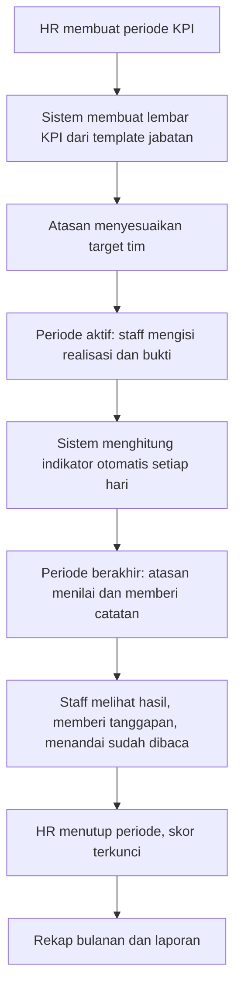

Status periode: `draft` → `active` → `in_review` → `closed`.  
Status lembar KPI: `target_setting` → `in_progress` → `in_review` → `reviewed` → `acknowledged`.

#### Functional requirements

| ID | Requirement | Prioritas |
|---|---|:-:|
| FR-KPI-01 | Template KPI per jabatan: indikator dengan nama, deskripsi, tipe pengukuran, satuan, target default, bobot | W |
| FR-KPI-02 | Data awal berisi template untuk 10 jabatan staff pada tabel di atas | W |
| FR-KPI-03 | Periode KPI: nama, tipe (mingguan/bulanan), tanggal mulai–selesai, batas penetapan target, batas review | W |
| FR-KPI-04 | Saat periode diaktifkan, sistem membuat lembar KPI untuk tiap karyawan aktif yang jabatannya punya template, dengan **menyalin** indikatornya | W |
| FR-KPI-05 | Atasan menyesuaikan target (dan bobot, bila diizinkan pengaturan) per karyawan sebelum batas penetapan target; perubahan tercatat | W |
| FR-KPI-06 | Staff mengisi realisasi indikator manual beserta catatan/bukti; bisa diperbarui sampai periode berakhir | W |
| FR-KPI-07 | Indikator otomatis dihitung ulang setiap hari dari data tugas, checklist, dan absensi | W |
| FR-KPI-08 | Review: atasan memverifikasi realisasi (boleh mengoreksi dengan catatan), mengisi indikator rating, menulis catatan evaluasi | W |
| FR-KPI-09 | Staff melihat hasil, menulis tanggapan (opsional), dan menandai sudah dibaca | W |
| FR-KPI-10 | HR menutup periode: semua lembar terkunci; lembar yang belum direview ditandai dan dilaporkan | W |
| FR-KPI-11 | Skor dan grade dihitung otomatis; ambang grade dan batas atas pencapaian bisa diatur | W |
| FR-KPI-12 | Rekap: per karyawan (tren antarperiode), per departemen (rata-rata dan sebaran grade), dan rekap bulanan dari periode mingguan (rata-rata skor mingguan) | W |
| FR-KPI-13 | Periode berulang: membuat periode berikutnya otomatis dengan menyalin target periode sebelumnya | S |
| FR-KPI-14 | Pengingat batas target, batas pengisian realisasi, dan batas review | S |
| FR-KPI-15 | HR dapat membuka kembali periode tertutup dengan alasan | O |

#### Aturan bisnis

- BR-KPI-01 — Total bobot indikator pada tiap template dan tiap lembar harus 100%.
- BR-KPI-02 — Tiap template wajib punya minimal satu indikator kualitas (`rating`), dan bobot gabungan indikator otomatis berbasis tugas (`auto_task_ontime` + `auto_checklist`) maksimal 50% (ambang bisa diatur). Ini menegakkan prinsip bahwa jumlah tugas bukan satu-satunya ukuran kinerja.
- BR-KPI-03 — Mengubah template tidak mengubah lembar yang sudah dibuat.
- BR-KPI-04 — Lembar dibuat menurut jabatan karyawan pada awal periode. Mutasi di tengah periode tidak mengganti lembar. Karyawan yang bergabung setelah periode dimulai ikut periode berikutnya, kecuali HR menambahkannya secara manual.
- BR-KPI-05 — Indikator otomatis tanpa pembagi (mis. tidak ada tugas jatuh tempo di periode itu) berstatus "tidak dinilai"; skor akhir = jumlah skor ÷ jumlah bobot yang dinilai × 100.
- BR-KPI-06 — Hari cuti/izin yang disetujui tidak mengurangi indikator kehadiran maupun checklist.
- BR-KPI-07 — Tidak ada yang menilai lembar KPI miliknya sendiri; penilai ditentukan dengan urutan yang sama seperti BR-APR-01.
- BR-KPI-08 — Setelah periode ditutup, nilai tidak bisa diubah kecuali periode dibuka kembali oleh HR.
- BR-KPI-09 — Staff hanya melihat KPI miliknya; skor karyawan lain tidak ditampilkan kepada staff dalam bentuk apa pun, termasuk peringkat.
- BR-KPI-10 — Realisasi yang dikoreksi atasan tetap menyimpan nilai asli dari staff beserta catatan koreksinya.

#### Acceptance criteria

- [ ] AC-KPI-01 — Template dengan total bobot selain 100% tidak bisa diaktifkan.
- [ ] AC-KPI-02 — Data pada contoh perhitungan di atas menghasilkan skor 89,18 dan grade B.
- [ ] AC-KPI-03 — Mengubah template setelah periode aktif tidak mengubah lembar periode berjalan.
- [ ] AC-KPI-04 — Indikator otomatis berubah paling lambat sehari setelah data sumbernya berubah.
- [ ] AC-KPI-05 — Staff tidak bisa membuka lembar KPI karyawan lain (403).
- [ ] AC-KPI-06 — Setelah periode ditutup, semua input pada lembar terkunci.
- [ ] AC-KPI-07 — Rekap bulanan sama dengan rata-rata skor periode mingguan dalam bulan itu.
- [ ] AC-KPI-08 — Indikator berstatus "tidak dinilai" tidak menurunkan skor akhir.

---

### M09 — Dashboard (F1, diperluas di F2 dan F3)

**Tujuan.** Satu halaman yang langsung menjawab "apa yang perlu saya lakukan hari ini" sesuai peran pengguna.  
**Halaman.** P-03.

#### Widget dan penerimanya

| # | Widget | Penerima | Fase |
|--:|---|---|:-:|
| 1 | Absensi hari ini (status + tombol clock-in/out) | Semua karyawan | F1 |
| 2 | Sisa saldo cuti saya | Semua karyawan | F1 |
| 3 | Pengajuan saya (terbaru + status) | Semua karyawan | F1 |
| 4 | Menunggu keputusan saya | Pemegang `leave.approve` / `attendance.correction.approve` / `leave.validate` | F1 |
| 5 | Kehadiran tim hari ini (hadir, terlambat, belum absen, cuti/izin) | Pemegang `attendance.view.team` | F1 |
| 6 | Siapa cuti 7 hari ke depan | Pemegang `leave.view.team` atau `leave.view.all` | F1 |
| 7 | Karyawan aktif per departemen | Pemegang `employee.view.all` (kecuali System Admin) | F1 |
| 8 | Kehadiran seluruh perusahaan hari ini + tren 30 hari | Pemegang `attendance.view.all` | F1 |
| 9 | Pengajuan macet (menunggu lebih dari 3 hari kerja) | HR Admin | F1 |
| 10 | Kontrak/masa percobaan berakhir dalam 30 hari | HR Admin | F1 |
| 11 | Karyawan baru dan keluar bulan ini | HR Admin, Management Viewer | F1 |
| 12 | Profil belum lengkap | HR Admin | F1 |
| 13 | Status sistem (akun aktif, login gagal 24 jam, backup terakhir, job gagal) | System Admin | F1 |
| 14 | Tugas saya hari ini dan terdekat; checklist harian saya | Semua karyawan | F2 |
| 15 | KPI saya pada periode berjalan | Semua karyawan | F2 |
| 16 | Tugas tim: terlambat, menunggu review, perlu dialihkan | Pemegang `task.view.team` | F2 |
| 17 | Ringkasan KPI tim | Pemegang `kpi.view.team` | F2 |
| 18 | Status payroll periode berjalan | Pemegang `payroll.manage` | F3 |

| ID | Requirement | Prioritas |
|---|---|:-:|
| FR-DSH-01 | Dashboard menampilkan widget sesuai permission pengguna; role ganda menghasilkan gabungan widget | W |
| FR-DSH-02 | Semua angka berasal dari database dan dihitung dalam cakupan data pengguna | W |
| FR-DSH-03 | Setiap angka atau kartu bisa diklik menuju daftar terfilter yang menjelaskan angka itu | W |
| FR-DSH-04 | Agregasi boleh di-*cache* paling lama 60 detik; widget pribadi (absensi hari ini) selalu terkini | W |
| FR-DSH-05 | Widget tanpa data menampilkan keadaan kosong yang menjelaskan, bukan sekadar angka 0 | W |
| FR-DSH-06 | Filter periode dan departemen pada widget tren bagi pemilik cakupan `all` | S |

**Acceptance criteria**
- [ ] AC-DSH-01 — Angka pada widget kehadiran tim sama dengan jumlah baris di daftar absensi tim dengan filter yang sama.
- [ ] AC-DSH-02 — Staff tidak menerima data tim/perusahaan; respons server untuk dashboard staff tidak memuat data itu.
- [ ] AC-DSH-03 — Dashboard termuat dalam batas waktu pada NFR dengan data uji.

---

### M10 — Reports (F1, diperluas di F2 dan F3)

**Tujuan.** Laporan yang bisa disaring, dipratinjau, dan diekspor tanpa mengolah ulang di luar sistem.  
**Halaman.** P-20.

| ID | Laporan | Isi utama | Filter | Akses | Fase |
|---|---|---|---|---|:-:|
| R-01 | Data karyawan | Daftar dan jumlah per departemen/jabatan/status kerja; masuk dan keluar per periode | Departemen, status, periode | HR, Management; ringkas untuk OPS | F1 |
| R-02 | Rekap absensi bulanan | Per karyawan: hari kerja, hadir, terlambat, menit terlambat, izin, sakit, cuti, alpa, lupa clock-out, jam kerja | Bulan, departemen, karyawan | Sesuai cakupan lihat absensi | F1 |
| R-03 | Detail absensi harian | Per tanggal: jam masuk, jam pulang, status, sumber data | Rentang tanggal, departemen, karyawan, status | Sesuai cakupan lihat absensi | F1 |
| R-04 | Keterlambatan | Frekuensi dan total menit terlambat per karyawan | Bulan, departemen | Sesuai cakupan lihat absensi | F1 |
| R-05 | Cuti dan izin | Pengajuan per jenis dan status; saldo per karyawan | Periode, jenis, departemen, status | Sesuai cakupan lihat cuti | F1 |
| R-06 | Tugas | Jumlah per status, persentase tepat waktu, rata-rata lama penyelesaian, putaran revisi, kepatuhan checklist harian | Periode, departemen, PIC | Sesuai cakupan lihat tugas | F2 |
| R-07 | KPI | Skor dan grade per karyawan, departemen, periode; tren | Periode, departemen | Sesuai cakupan lihat KPI | F2 |
| R-08 | Payroll | Rekap gaji per periode dan per komponen | Periode, departemen | `payroll.report.view` | F3 |
| R-09 | Audit log | Aktivitas yang tercatat | Rentang tanggal, pelaku, modul, aksi | `audit.view` | F1 |

Staff mendapat versi pribadi dari R-02, R-05, dan (F2) R-07 lewat halaman modulnya masing-masing.

| ID | Requirement | Prioritas |
|---|---|:-:|
| FR-RPT-01 | Halaman Laporan hanya menampilkan laporan yang boleh diakses pengguna | W |
| FR-RPT-02 | Tiap laporan: filter → pratinjau tabel berpaginasi dengan ringkasan angka → ekspor | W |
| FR-RPT-03 | Ekspor Excel (.xlsx) dan PDF (A4). PDF memakai kop perusahaan dari Pengaturan dan memuat judul, periode, filter, waktu cetak, nama pencetak, nomor halaman | W |
| FR-RPT-04 | Ekspor lebih dari 5.000 baris diproses di antrean; pengguna diberi notifikasi saat berkas siap; berkas tersimpan privat dan kedaluwarsa 24 jam | W |
| FR-RPT-05 | Isi laporan mengikuti cakupan data pengguna; kolom sensitif mengikuti permission | W |
| FR-RPT-06 | Setiap ekspor tercatat di audit log: siapa, laporan apa, filter, jumlah baris | W |
| FR-RPT-07 | Karyawan nonaktif tetap muncul pada periode saat ia masih aktif | W |
| FR-RPT-08 | Grafik ringkas pada pratinjau (mis. tren kehadiran, sebaran grade) | S |

**Acceptance criteria**
- [ ] AC-RPT-01 — Angka R-02 untuk satu karyawan sama dengan halaman riwayat absensinya.
- [ ] AC-RPT-02 — Ekspor R-02 oleh manager hanya berisi timnya.
- [ ] AC-RPT-03 — PDF memuat kop, periode, filter, waktu cetak, dan nama pencetak.
- [ ] AC-RPT-04 — Tautan unduhan ekspor tidak bisa dipakai pengguna lain dan tidak berlaku setelah 24 jam.
- [ ] AC-RPT-05 — Setiap ekspor muncul di audit log.

---

### M11 — Notifications (F1, event ditambah per fase)

**Tujuan.** Orang yang perlu bertindak atau perlu tahu mendapat kabar tepat waktu, tanpa membocorkan data sensitif.  
**Halaman.** P-21.

#### Daftar event

| ID | Peristiwa | Penerima | Kanal | Fase |
|---|---|---|---|:-:|
| N-01 | Akun dibuat atau password direset | Pemilik akun | Email | F1 |
| N-02 | Pengajuan cuti/izin baru menunggu keputusan | Approver langkah aktif atau penggantinya | App, Email | F1 |
| N-03 | Cuti/izin disetujui atasan dan lanjut ke HR | Pemohon, kelompok HR | App | F1 |
| N-04 | Cuti/izin disetujui final | Pemohon, atasan; HR bila tanpa tahap HR | App, Email | F1 |
| N-05 | Cuti/izin ditolak | Pemohon | App, Email | F1 |
| N-06 | Pengajuan dibatalkan | Approver yang terlibat, HR | App | F1 |
| N-07 | Koreksi absensi baru menunggu keputusan | Approver | App, Email | F1 |
| N-08 | Koreksi absensi diputuskan | Pemohon | App | F1 |
| N-09 | Lupa clock-out | Karyawan | App | F1 |
| N-10 | Belum clock-in 30 menit setelah jam masuk (bisa dimatikan) | Karyawan | App | F1 |
| N-11 | Pengingat: approval menunggu lebih dari 1 hari kerja | Approver | App, Email | F1 |
| N-12 | Eskalasi: approval menunggu lebih dari 3 hari kerja | HR | App | F1 |
| N-13 | Approval dialihkan atau delegasi dimulai | Approver baru dan lama | App | F1 |
| N-14 | Kontrak/masa percobaan berakhir (H-30, H-7) | HR | App, Email | F1 |
| N-15 | Departemen tanpa manager atau karyawan tanpa atasan | HR | App | F1 |
| N-16 | Ekspor laporan siap diunduh | Peminta | App | F1 |
| N-17 | Saldo cuti disesuaikan HR | Karyawan | App | F1 |
| N-18 | Tugas baru ditugaskan atau PIC diganti | PIC, anggota | App, Email | F2 |
| N-19 | Tugas dikirim untuk direview | Reviewer | App | F2 |
| N-20 | Tugas disetujui atau diminta revisi | PIC | App | F2 |
| N-21 | Tenggat tugas: H-1, hari-H, terlambat | PIC; saat terlambat juga reviewer | App | F2 |
| N-22 | Komentar baru atau disebut di komentar | PIC, reviewer, orang yang disebut | App | F2 |
| N-23 | Periode KPI dimulai, batas target, batas review | Atasan, staff | App, Email | F2 |
| N-24 | Hasil KPI siap dilihat | Staff | App | F2 |
| N-25 | Slip gaji terbit | Karyawan | App, Email | F3 |
| N-26 | Payroll menunggu persetujuan | Penyetuju payroll | App, Email | F3 |

| ID | Requirement | Prioritas |
|---|---|:-:|
| FR-NTF-01 | Notifikasi dalam aplikasi: ikon lonceng dengan jumlah belum dibaca, panel ringkas, dan halaman daftar | W |
| FR-NTF-02 | Tiap notifikasi punya judul, ringkasan, waktu, dan tautan ke objeknya; membukanya menandai sudah dibaca | W |
| FR-NTF-03 | Tandai semua sudah dibaca; filter belum dibaca | W |
| FR-NTF-04 | Email dikirim lewat antrean dan dicoba ulang hingga 3 kali; kegagalan email tidak menggagalkan proses utama | W |
| FR-NTF-05 | Jumlah belum dibaca diperbarui berkala (setiap 60 detik) tanpa memuat ulang halaman | W |
| FR-NTF-06 | Isi email tidak memuat data sensitif (alasan sakit, nominal gaji); cukup ringkasan dan tautan | W |
| FR-NTF-07 | Tautan notifikasi tetap tunduk pada permission | W |
| FR-NTF-08 | Pengguna dapat mematikan email per kategori; notifikasi dalam aplikasi selalu aktif | S |
| FR-NTF-09 | Notifikasi yang lebih tua dari 90 hari dihapus otomatis | S |

**Acceptance criteria**
- [ ] AC-NTF-01 — Pengajuan cuti memunculkan notifikasi pada approver paling lambat 1 menit kemudian.
- [ ] AC-NTF-02 — Saat server email mati, pengajuan tetap tersimpan dan notifikasi dalam aplikasi tetap muncul.
- [ ] AC-NTF-03 — Email tentang izin sakit tidak memuat alasannya; email slip gaji tidak memuat nominal.
- [ ] AC-NTF-04 — Pengingat approval dikirim paling banyak sekali per hari untuk tiap pengajuan.

---

### M12 — Settings & Audit Log (F1)

**Tujuan.** Semua kebijakan bisa diubah oleh orang yang berwenang tanpa mengubah kode, dan setiap perubahan penting meninggalkan jejak.  
**Halaman.** P-22.

#### Sub-menu Pengaturan

| Sub-menu | Isi | Permission |
|---|---|---|
| Profil Perusahaan | Nama, alamat, kontak, logo (dipakai di kop laporan dan slip) | `settings.general.manage` |
| Umum | Zona waktu default, format nomor karyawan, lama sesi, email aktif/mati | `settings.general.manage` |
| Organisasi | Departemen, jabatan, lokasi kerja | `settings.org.manage` |
| Jadwal & Libur | Jadwal kerja, hari libur, batas koreksi, pembatasan IP | `settings.attendance.manage` |
| Jenis Cuti & Saldo | Jenis cuti beserta aturannya, kebijakan saldo tahunan | `settings.leave.manage` |
| Approval | Approver cadangan, approver puncak, ambang pengingat dan eskalasi, daftar delegasi | `settings.approval.manage` |
| KPI (F2) | Template per jabatan, ambang grade, batas atas pencapaian | `kpi.manage` |
| Akun | Daftar akun, reset password, aktif/nonaktif, role per akun | `user.manage` |
| Role & Permission | Matriks permission per role | `rbac.manage` |
| Audit Log | Daftar dan detail aktivitas | `audit.view` |

| ID | Requirement | Prioritas |
|---|---|:-:|
| FR-SET-01 | Semua pengaturan di atas bisa diubah lewat antarmuka oleh pemegang permission-nya | W |
| FR-SET-02 | Setiap perubahan pengaturan dan data master dicatat di audit log (nilai lama → baru) | W |
| FR-SET-03 | Perubahan aturan (jadwal, toleransi, jenis cuti) berlaku ke depan dan tidak menghitung ulang data lampau | W |
| FR-SET-04 | Tujuh role bawaan tidak bisa dihapus; permission-nya bisa diubah System Admin | W |
| FR-SET-05 | Sistem menolak perubahan yang membuat tidak ada lagi akun aktif pemegang `rbac.manage` | W |
| FR-SET-06 | Audit log: filter rentang tanggal, pelaku, modul, aksi, objek; detail menampilkan nilai lama dan baru | W |
| FR-SET-07 | Audit log tidak bisa diubah atau dihapus dari aplikasi dan disimpan minimal 2 tahun | W |
| FR-SET-08 | Role kustom bisa ditambahkan System Admin | S |

#### Peristiwa yang wajib masuk audit log

- **Akses:** login berhasil dan gagal, logout, ganti dan reset password.
- **Akun & hak akses:** pembuatan/penonaktifan akun, perubahan role dan permission.
- **Karyawan:** tambah, ubah, nonaktifkan, reaktivasi, mutasi; perubahan dan pembukaan field sensitif; unggah, unduh, hapus dokumen.
- **Absensi:** input manual HR, koreksi yang diterapkan, kunci dan buka periode.
- **Cuti & approval:** pengajuan, keputusan, pengalihan, delegasi, pembatalan oleh HR, penyesuaian saldo.
- **Pengaturan:** semua perubahan pengaturan dan data master.
- **Data keluar-masuk:** ekspor dan impor.
- **F2:** perubahan target, realisasi, dan penilaian KPI; tutup/buka periode; pembatalan dan pengalihan tugas.
- **F3:** semua perubahan payroll dan pembukaan slip milik orang lain.

Setiap entri memuat: pelaku, waktu (UTC), aksi, modul, jenis dan ID objek, nilai lama, nilai baru, IP, dan perangkat. Nilai sensitif disimpan ter-*mask*.

**Acceptance criteria**
- [ ] AC-SET-01 — Mengubah toleransi terlambat memengaruhi absensi hari berikutnya dan tidak mengubah status hari-hari lalu.
- [ ] AC-SET-02 — Upaya mencabut `rbac.manage` dari admin terakhir ditolak.
- [ ] AC-SET-03 — Tidak ada rute atau aksi di aplikasi untuk mengubah atau menghapus audit log.
- [ ] AC-SET-04 — Perubahan nomor rekening tercatat di audit log dengan nilai ter-*mask*.

---

### M13 — Payroll (F3)

**Tujuan.** Menghitung gaji dari data kehadiran yang sudah terkunci, dengan persetujuan dan slip yang aman. Rincian di bawah menjadi dasar; kebijakan pada K-10 perlu final sebelum fase ini dimulai.  
**Aktor.** HR Admin dan Finance (mengelola), penyetuju payroll, semua karyawan (slip sendiri).  
**Halaman.** P-23.

#### Komponen default (bisa diubah)

| Kode | Nama | Jenis | Cara hitung |
|---|---|---|---|
| `BASIC` | Gaji pokok | Pendapatan | Tetap per bulan |
| `ALLOW_FIXED` | Tunjangan tetap | Pendapatan | Tetap per bulan |
| `MEAL` | Uang makan siang | Pendapatan | Hari hadir × tarif harian |
| `BONUS` | Bonus/insentif | Pendapatan | Input manual atau impor Excel |
| `OVERTIME` | Lembur | Pendapatan | Input manual |
| `DED_ABSENCE` | Potongan alpa/terlambat | Potongan | Sesuai kebijakan, atau manual |
| `DED_BPJS` | BPJS | Potongan | Input manual |
| `DED_TAX` | PPh 21 | Potongan | Input manual |
| `DED_LOAN` | Kasbon/pinjaman | Potongan | Input manual |

#### Alur

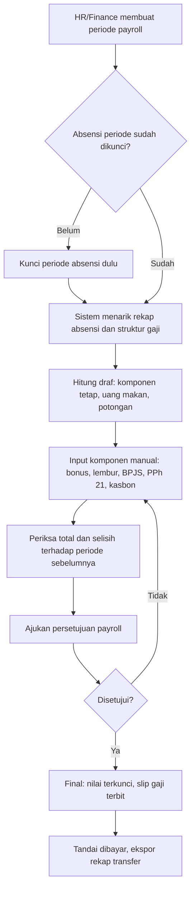

Status periode payroll: `draft` → `calculated` → `in_approval` → `approved` → `paid`.

| ID | Requirement | Prioritas |
|---|---|:-:|
| FR-PAY-01 | Komponen gaji: kode, nama, jenis (pendapatan/potongan), cara hitung (tetap, per hari hadir, manual), aktif/nonaktif | W |
| FR-PAY-02 | Struktur gaji per karyawan: nilai tiap komponen tetap dengan tanggal efektif, sehingga riwayat perubahan tersimpan | W |
| FR-PAY-03 | Periode payroll: nama, rentang tanggal, tanggal bayar. Hanya bisa dihitung setelah periode absensi terkait dikunci (FR-ATT-09) | W |
| FR-PAY-04 | Draf dihitung otomatis: komponen tetap + uang makan dari hari hadir; prorata bagi karyawan yang masuk/keluar di tengah periode | W |
| FR-PAY-05 | Input komponen manual per karyawan atau lewat impor Excel | W |
| FR-PAY-06 | Layar pemeriksaan: total per komponen, karyawan dengan selisih terbesar terhadap periode sebelumnya, peringatan nilai janggal (neto negatif, rekening kosong) | W |
| FR-PAY-07 | Persetujuan lewat approval engine oleh pemegang `payroll.approve`; pembuat tidak boleh menyetujui sendiri | W |
| FR-PAY-08 | Finalisasi mengunci nilai. Koreksi setelah final dilakukan sebagai penyesuaian di periode berikutnya, atau pembukaan ulang oleh penyetuju dengan alasan | W |
| FR-PAY-09 | Slip gaji PDF berkop perusahaan per karyawan. Karyawan hanya membuka slip miliknya; pembukaan slip orang lain oleh petugas dicatat | W |
| FR-PAY-10 | Ekspor rekap transfer (nama, bank, nomor rekening, nominal) dan laporan R-08 | W |
| FR-PAY-11 | Menandai periode sudah dibayar beserta tanggal bayar aktual | W |
| FR-PAY-12 | Riwayat slip tersedia bagi karyawan selama aktif, dan bagi petugas payroll tanpa batas waktu | W |

**Aturan bisnis**
- BR-PAY-01 — Nominal gaji hanya terlihat oleh pemiliknya dan pemegang permission payroll. Atasan tidak melihat gaji timnya.
- BR-PAY-02 — Semua perubahan nominal tercatat di audit log.
- BR-PAY-03 — "Hari hadir" untuk uang makan = hari berstatus Hadir atau Terlambat yang punya clock-in.
- BR-PAY-04 — Semua nominal berupa bilangan bulat rupiah; pembulatan dilakukan per komponen.
- BR-PAY-05 — Neto = total pendapatan − total potongan. Neto negatif memblokir finalisasi.
- BR-PAY-06 — Sistem tidak menghitung PPh 21 dan BPJS; angkanya diinput petugas (K-10).
- BR-PAY-07 — Slip tidak dikirim sebagai lampiran email; email hanya berisi pemberitahuan dan tautan.

**Yang perlu diputuskan sebelum F3:** tanggal tutup buku dan tanggal gajian · tarif uang makan dan apakah hari terlambat tetap dihitung · aturan potongan alpa/terlambat · siapa penyetuju payroll · sumber data bonus per departemen · cara prorata karyawan baru/keluar.

**Acceptance criteria**
- [ ] AC-PAY-01 — Karyawan dengan 22 hari hadir dan tarif uang makan Rp20.000 memperoleh uang makan Rp440.000.
- [ ] AC-PAY-02 — Payroll tidak bisa dihitung selama periode absensi belum dikunci.
- [ ] AC-PAY-03 — Manager tidak bisa melihat nominal gaji timnya di halaman, laporan, maupun ekspor.
- [ ] AC-PAY-04 — Pembuat payroll tidak bisa menyetujui payroll yang ia ajukan.
- [ ] AC-PAY-05 — Setelah final, nilai tidak bisa diubah tanpa pembukaan ulang yang tercatat.
- [ ] AC-PAY-06 — Karyawan tidak bisa membuka slip orang lain, dan berkas slip tidak bisa diakses lewat URL publik.

---

### M14 — Recruitment, Onboarding, Offboarding (F3)

**Tujuan.** Melacak kandidat sampai menjadi karyawan, lalu memastikan langkah masuk dan keluar karyawan tidak ada yang terlewat.  
**Aktor.** HR Admin (mengelola), manager (menilai kandidat departemennya), penanggung jawab item checklist.  
**Halaman.** P-24.

| ID | Requirement | Prioritas |
|---|---|:-:|
| FR-REC-01 | Lowongan: jabatan, departemen, jumlah kebutuhan, deskripsi, penanggung jawab, status (draf, dibuka, ditutup) | W |
| FR-REC-02 | Kandidat: nama, kontak, sumber, CV (berkas privat), lowongan yang dilamar, catatan. Diinput manual atau diimpor dari Excel/CSV | W |
| FR-REC-03 | Tahapan: Lamaran masuk → Seleksi berkas → Interview → Penawaran → Diterima / Tidak lolos / Mengundurkan diri. Tiap perpindahan tercatat dengan pelaku dan waktu | W |
| FR-REC-04 | Penilaian interview: pewawancara, termasuk manager departemen terkait, mengisi skor dan catatan | W |
| FR-REC-05 | Kandidat Diterima dikonversi menjadi karyawan; datanya terisi otomatis di form tambah karyawan (FR-EMP-01) | W |
| FR-REC-06 | Template checklist onboarding per jabatan/departemen: item, penanggung jawab (HR, IT, atasan, karyawan), tenggat relatif terhadap tanggal bergabung | W |
| FR-REC-07 | Saat karyawan baru dibuat, checklist onboarding terbentuk otomatis. Tiap penanggung jawab melihat item miliknya; HR dan atasan melihat progresnya | W |
| FR-REC-08 | Template checklist offboarding (serah terima pekerjaan, pengembalian aset, pencabutan akses, dokumen keluar) terbentuk otomatis saat karyawan dijadwalkan keluar (FR-EMP-07) | W |
| FR-REC-09 | Laporan rekrutmen: jumlah kandidat per tahap, lama proses per lowongan, sumber kandidat | S |
| FR-REC-10 | Data kandidat yang tidak diterima dihapus atau dianonimkan setelah masa simpan (default 12 bulan) | S |

**Aturan bisnis**
- BR-REC-01 — Manager hanya melihat kandidat untuk lowongan di departemennya.
- BR-REC-02 — CV dan data kandidat tersimpan privat, dan aksesnya dicatat.
- BR-REC-03 — Kandidat dengan email atau nomor HP yang sama pada lowongan berbeda dikenali sebagai orang yang sama.
- BR-REC-04 — Penonaktifan akun tetap berjalan pada tanggal keluar walaupun checklist offboarding belum tuntas; item yang belum selesai tetap terbuka bagi penanggung jawabnya.

**Acceptance criteria**
- [ ] AC-REC-01 — Konversi kandidat menghasilkan karyawan tanpa mengetik ulang nama, kontak, dan jabatan.
- [ ] AC-REC-02 — Checklist onboarding terbentuk otomatis saat karyawan baru dibuat dan muncul pada tiap penanggung jawab.
- [ ] AC-REC-03 — Manager tidak melihat kandidat di luar lowongan departemennya.
- [ ] AC-REC-04 — Saat karyawan dijadwalkan keluar, checklist offboarding terbentuk dan item pencabutan akses muncul pada penanggung jawabnya.

---

## 8. Rancangan Database

### 8.1 Konvensi

- Semua tabel punya `id` (BIGINT, auto increment), `created_at`, dan `updated_at`, kecuali disebut lain.
- Waktu kejadian (`*_at`) bertipe DATETIME dalam **UTC**. Tanggal kalender (`*_date`, `work_date`) bertipe DATE tanpa zona waktu.
- Foreign key memakai `ON DELETE RESTRICT`. Soft delete (`deleted_at`) hanya pada tabel yang mencantumkannya.
- Nilai pilihan (status, tipe) disimpan sebagai string dan divalidasi dengan enum di aplikasi, supaya menambah nilai tidak perlu mengubah struktur tabel.
- Uang disimpan sebagai BIGINT (rupiah bulat). Jumlah hari cuti memakai DECIMAL(5,1).
- Kolom bertanda 🔒 dienkripsi di tingkat aplikasi (tipe TEXT).
- Karakter set `utf8mb4`.

### 8.2 Tabel F1 — Akun, organisasi, karyawan

| Tabel | Kolom | Kunci, indeks, catatan |
|---|---|---|
| `users` | `employee_id` (FK, nullable), `name`, `email`, `password`, `must_change_password`, `is_active`, `last_login_at`, `last_login_ip`, `remember_token` | Unik: `email`, `employee_id`. Akun tanpa karyawan hanya untuk System Admin dan Management Viewer |
| `roles`, `permissions`, `model_has_roles`, `role_has_permissions`, `model_has_permissions` | Mengikuti skema paket RBAC | Menggantikan `user_roles` dan `role_permissions` pada v1 |
| `sessions`, `password_reset_tokens`, `jobs`, `failed_jobs`, `cache` | Bawaan framework | – |
| `departments` | `code`, `name`, `manager_employee_id` (FK, nullable), `is_active` | Unik: `code` |
| `positions` | `department_id` (FK), `name`, `level` (`staff`/`manager`/`head`), `default_role`, `is_active` | Unik: (`department_id`, `name`) |
| `work_locations` | `name`, `timezone`, `ip_whitelist` (JSON, nullable), `is_active` | `timezone` berformat IANA |
| `work_schedules` | `name`, `work_days` (JSON, mis. `[1,2,3,4,5]`), `start_time`, `end_time`, `break_minutes`, `late_tolerance_minutes`, `is_default` | Tepat satu baris `is_default` |
| `holidays` | `date`, `name`, `type` (`national`/`joint_leave`/`company`), `work_location_id` (FK, nullable = semua lokasi) | Unik: (`date`, `work_location_id`); duplikat untuk lokasi kosong dicegah di aplikasi |
| `employees` | `employee_number`, `full_name`, `nickname`, `gender`, `birth_place`, `birth_date`, `photo_path`, `personal_email`, `phone`, `address`, `emergency_contact_name`, `emergency_contact_relation`, `emergency_contact_phone`, `join_date`, `employment_status`, `contract_end_date`, `work_location_id` (FK), `work_schedule_id` (FK), `is_active`, `exit_date`, `exit_reason`, `exit_notes`, 🔒`national_id`, 🔒`tax_id`, 🔒`bpjs_health_no`, 🔒`bpjs_employment_no`, `bank_name`, 🔒`bank_account_no`, `bank_account_holder`, `deleted_at` | Unik: `employee_number`. Indeks: `is_active`, `full_name` |
| `employee_assignments` | `employee_id` (FK), `department_id` (FK), `position_id` (FK), `manager_id` (FK ke `employees`, nullable), `type` (`initial`/`promotion`/`mutation`/`demotion`/`manager_change`), `effective_from`, `effective_to` (nullable), `notes`, `created_by` | Indeks: (`employee_id`, `effective_from`), (`manager_id`, `effective_to`), (`department_id`, `effective_to`) |
| `employee_documents` | `employee_id` (FK), `category`, `title`, `file_path`, `mime_type`, `size_bytes`, `uploaded_by` | Berkas di penyimpanan privat |

### 8.3 Tabel F1 — Absensi, cuti, approval

| Tabel | Kolom | Kunci, indeks, catatan |
|---|---|---|
| `attendance_records` | `employee_id` (FK), `work_date`, `timezone`, `scheduled_start`, `scheduled_end`, `clock_in_at`, `clock_out_at`, `clock_in_ip`, `clock_out_ip`, `clock_in_agent`, `status`, `late_minutes`, `early_leave_minutes`, `work_minutes` (nullable), `is_incomplete`, `is_off_day`, `source` (`self`/`correction`/`hr_manual`/`system`), `leave_request_id` (FK, nullable), `notes` | Unik: (`employee_id`, `work_date`). Indeks: (`work_date`, `status`) |
| `attendance_qr_tokens` | `token` (PK string), `work_location_id` (FK, nullable), `secret_hash`, `expires_at`, `created_by` (FK), `is_active` | Token berotasi untuk scanner Dynamic QR di kantor |
| `attendance_corrections` | `employee_id` (FK), `attendance_record_id` (FK, nullable), `work_date`, `requested_clock_in_at`, `requested_clock_out_at`, `reason`, `status`, `original_snapshot` (JSON), `applied_at` | Indeks: (`employee_id`, `work_date`) |
| `attendance_period_locks` | `year`, `month`, `is_locked`, `locked_by`, `locked_at`, `unlocked_by`, `unlocked_at`, `unlock_reason` | Unik: (`year`, `month`). Riwayat kunci/buka ada di audit log |
| `leave_types` | `code`, `name`, `deducts_balance`, `count_mode` (`working_days`/`calendar_days`), `attachment_required_after_days` (nullable), `requires_hr_validation`, `min_notice_days`, `backdate_max_days`, `max_days_per_request` (nullable), `is_paid`, `attendance_status` (`leave`/`sick`/`permit`), `is_active` | Unik: `code` |
| `leave_balances` | `employee_id` (FK), `leave_type_id` (FK), `year`, `entitlement`, `carried_over`, `adjustment`, `used`, `pending` | Unik: (`employee_id`, `leave_type_id`, `year`) |
| `leave_balance_adjustments` | `leave_balance_id` (FK), `amount`, `reason`, `created_by`, `created_at` | Jejak setiap penyesuaian saldo |
| `leave_requests` | `employee_id` (FK), `leave_type_id` (FK), `start_date`, `end_date`, `total_days`, `reason`, `status`, `submitted_by` (FK ke `users`), `cancelled_by`, `cancelled_at`, `cancel_reason` | Indeks: (`employee_id`, `start_date`, `end_date`), `status` |
| `approval_requests` | `approvable_type`, `approvable_id`, `requester_employee_id` (FK), `status` (`pending`/`approved`/`rejected`/`cancelled`), `current_step`, `no_manager_flag` | Unik: (`approvable_type`, `approvable_id`) |
| `approval_steps` | `approval_request_id` (FK), `step_order`, `step_type` (`direct_manager`/`hr`/`specific`), `approver_employee_id` (FK, nullable = kelompok), `approver_permission` (nullable), `status` (`waiting`/`pending`/`approved`/`rejected`/`skipped`), `decided_by` (FK), `on_behalf_of` (FK, nullable), `decided_at`, `notes`, `reassigned_from` (FK, nullable), `last_reminded_at` | Unik: (`approval_request_id`, `step_order`). Indeks: (`approver_employee_id`, `status`) |
| `approval_delegations` | `from_employee_id` (FK), `to_employee_id` (FK), `start_date`, `end_date`, `reason`, `created_by`, `revoked_at` | Indeks: (`from_employee_id`, `start_date`, `end_date`) |

### 8.4 Tabel Bersama

| Tabel | Kolom | Kunci, indeks, catatan |
|---|---|---|
| `attachments` | `attachable_type`, `attachable_id`, `file_name`, `file_path`, `mime_type`, `size_bytes`, `uploaded_by` | Indeks: (`attachable_type`, `attachable_id`) |
| `notifications` | Skema bawaan framework: `id` (UUID), `type`, `notifiable_type`, `notifiable_id`, `data` (JSON), `read_at` | Indeks bawaan: (`notifiable_type`, `notifiable_id`) |
| `audit_logs` | `actor_user_id` (nullable = sistem), `action`, `module`, `entity_type`, `entity_id`, `old_values` (JSON), `new_values` (JSON), `metadata` (JSON), `ip_address`, `user_agent`, `created_at` | Tanpa `updated_at`. Indeks: (`entity_type`, `entity_id`), (`actor_user_id`, `created_at`), (`module`, `created_at`) |
| `settings` | `key` (PK), `value` (JSON), `updated_by`, `updated_at` | Pengaturan umum dan kebijakan |
| `exports` | `user_id` (FK), `report_key`, `filters` (JSON), `row_count`, `file_path`, `status` (`queued`/`ready`/`failed`/`expired`), `expires_at` | Berkas dihapus saat kedaluwarsa |
| `import_batches` | `user_id` (FK), `type`, `file_path`, `total_rows`, `success_rows`, `failed_rows`, `error_file_path`, `status` | Jejak tiap impor |

### 8.5 Tabel Daily Report dan KPI

| Tabel | Kolom | Kunci, indeks, catatan |
|---|---|---|
| `daily_reports` | `employee_id` (FK), `department_id` (FK), `report_date`, `status` (`draft`/`submitted`/`needs_revision`/`accepted`), `submitted_at`, `reviewed_at`, `reviewed_by` (FK ke `users`, nullable), `revision_notes` (nullable), `total_entries`, `work_hours_estimate` (nullable) | Unik: (`employee_id`, `report_date`). Indeks: (`department_id`, `report_date`, `status`) |
| `daily_report_entries` | `daily_report_id` (FK), `row_order`, `start_time`, `end_time`, `activity`, `result`, `status` (`pending`/`in_progress`/`completed`), `notes` (nullable), `extra_data` (JSON, nullable) | Indeks: (`daily_report_id`, `row_order`) |
| `daily_report_reviews` | `daily_report_id` (FK), `reviewer_id` (FK ke `users`), `action` (`accept`/`request_revision`), `notes`, `created_at` | Log riwayat review manager per laporan |
| `daily_report_templates` | `department_id` (FK, nullable), `position_id` (FK, nullable), `name`, `extra_fields_schema` (JSON), `is_active` | Template kolom dinamis per departemen |
| `kpi_templates` | `position_id` (FK), `name`, `is_active` | Satu template aktif per jabatan |
| `kpi_indicators` | `kpi_template_id` (FK), `name`, `description`, `measurement_type`, `unit`, `default_target`, `weight`, `sort_order` | Total `weight` per template = 100 |
| `kpi_periods` | `name`, `type` (`weekly`/`monthly`), `start_date`, `end_date`, `target_deadline`, `review_deadline`, `status` | Periode setipe tidak boleh tumpang-tindih |
| `employee_kpis` | `employee_id` (FK), `kpi_period_id` (FK), `kpi_template_id` (FK), `position_id` (FK), `reviewer_employee_id` (FK), `status`, `final_score`, `grade`, `manager_notes`, `employee_response`, `reviewed_at`, `acknowledged_at` | Unik: (`employee_id`, `kpi_period_id`) |
| `employee_kpi_items` | `employee_kpi_id` (FK), `kpi_indicator_id` (FK, nullable), `name`, `measurement_type`, `unit`, `weight`, `target_value`, `actual_value`, `actual_value_reported`, `achievement`, `weighted_score`, `is_not_assessed`, `evidence_note`, `correction_note` | Salinan indikator saat lembar dibuat |

### 8.6 Tabel F3 — Payroll, rekrutmen, checklist

| Tabel | Kolom | Kunci, indeks, catatan |
|---|---|---|
| `payroll_components` | `code`, `name`, `type` (`earning`/`deduction`), `calc_type` (`fixed`/`per_attendance_day`/`manual`), `is_active` | Unik: `code` |
| `employee_salary_components` | `employee_id` (FK), `payroll_component_id` (FK), `amount`, `effective_from`, `effective_to` | Riwayat nilai per komponen |
| `payroll_periods` | `name`, `start_date`, `end_date`, `pay_date`, `paid_at`, `status`, `created_by` | – |
| `payroll_records` | `payroll_period_id` (FK), `employee_id` (FK), `attendance_summary` (JSON), `gross_pay`, `total_deductions`, `net_pay`, `slip_path`, `status` | Unik: (`payroll_period_id`, `employee_id`) |
| `payroll_record_items` | `payroll_record_id` (FK), `payroll_component_id` (FK), `name`, `type`, `amount`, `note` | Rincian slip |
| `job_openings` | `position_id` (FK), `department_id` (FK), `headcount`, `description`, `owner_employee_id` (FK), `status` | – |
| `candidates` | `full_name`, `email`, `phone`, `source`, `cv_path`, `notes`, `anonymized_at` | Indeks: `email`, `phone` |
| `candidate_applications` | `candidate_id` (FK), `job_opening_id` (FK), `stage`, `stage_changed_at`, `outcome_reason`, `converted_employee_id` (FK, nullable) | Unik: (`candidate_id`, `job_opening_id`) |
| `candidate_stage_logs` | `candidate_application_id` (FK), `from_stage`, `to_stage`, `changed_by`, `note`, `created_at` | – |
| `interview_scores` | `candidate_application_id` (FK), `interviewer_employee_id` (FK), `score`, `notes` | – |
| `checklist_templates` | `type` (`onboarding`/`offboarding`), `name`, `department_id` (nullable), `position_id` (nullable), `is_active` | – |
| `checklist_template_items` | `checklist_template_id` (FK), `title`, `owner_type` (`hr`/`it`/`manager`/`employee`), `due_offset_days`, `is_required`, `sort_order` | – |
| `employee_checklists` | `employee_id` (FK), `checklist_template_id` (FK), `type`, `anchor_date`, `status` | – |
| `employee_checklist_items` | `employee_checklist_id` (FK), `title`, `owner_employee_id` (FK), `due_date`, `is_required`, `is_done`, `done_by`, `done_at`, `note` | – |

### 8.7 Relasi inti

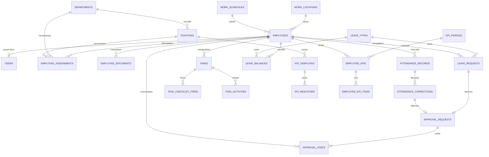

### 8.8 Catatan rancangan

- **Penempatan aktif** pada tanggal D adalah baris `employee_assignments` dengan `effective_from <= D` dan (`effective_to` kosong atau `effective_to >= D`).
- **Atasan langsung** bersumber dari `employee_assignments.manager_id`. Kolom `departments.manager_employee_id` hanya cadangan saat atasan langsung kosong (BR-APR-01).
- **Perubahan struktur dari v1:**
  - `leave_requests.leave_type` (teks) menjadi foreign key ke `leave_types`.
  - `approval_steps` kini berada di bawah `approval_requests`, sehingga satu pengajuan bisa punya beberapa langkah berurutan.
  - `task_assignees` diganti `tasks.pic_employee_id` (satu PIC) + `task_members` (anggota).
  - `task_updates` dipecah menjadi `task_activities` (riwayat) dan `task_comments` (komentar).
  - `employee_kpis` menjadi kepala lembar, rinciannya di `employee_kpi_items`; `performance_reviews` dilebur ke `employee_kpis`.
- **Data awal (seeder):** role dan permission, departemen dan jabatan, lokasi kerja dan jadwal default, jenis cuti, pengaturan default, akun System Admin pertama; template KPI (F2); komponen payroll (F3).
- **Retensi:** tidak ada penghapusan otomatis kecuali notifikasi (90 hari), berkas ekspor (24 jam), dan data kandidat (FR-REC-10).
- **Migrasi data awal:** karyawan, penempatan, dan saldo cuti awal dimuat lewat impor Excel (FR-EMP-12, FR-LEV-10), bukan lewat perubahan langsung di database.

---

## 9. Arsitektur dan Teknologi

### 9.1 Pilihan teknologi

Arsitektur: **satu aplikasi (monolit) Laravel**. Untuk aplikasi internal berskala ini, satu basis kode lebih cepat dibangun, lebih mudah diamankan, dan lebih murah dirawat daripada backend dan frontend terpisah.

| Lapisan | Pilihan | Catatan |
|---|---|---|
| Backend | Laravel, versi stabil terbaru saat proyek dimulai | Pusat autentikasi, validasi, aturan bisnis, otorisasi |
| Frontend | **Rekomendasi:** Blade + Livewire + Alpine.js. Alternatif: Inertia + React + TypeScript bila tim lebih kuat di React | Rekomendasi dipilih karena tidak butuh API terpisah. PRD Design tidak bergantung pada pilihan ini |
| UI | Tailwind CSS dengan token pada PRD Design | – |
| Database | MySQL 8 (InnoDB, `utf8mb4`) | – |
| Cache, antrean, sesi | Redis | Boleh mulai dengan driver database bila server kecil |
| Autentikasi | Sesi berbasis cookie bawaan Laravel | Sanctum hanya bila kelak perlu API untuk aplikasi lain |
| Otorisasi | Policies/Gates + paket RBAC (mis. `spatie/laravel-permission`) | – |
| Excel dan PDF | Paket ekspor/impor Excel (mis. `maatwebsite/excel`) dan PDF (mis. `barryvdh/laravel-dompdf`) | Boleh diganti paket setara |
| Berkas | Disk privat di server, dilayani lewat rute berizin | Siap dipindah ke penyimpanan S3-compatible |
| Penjadwalan | Laravel Scheduler + queue worker | – |
| Backup | Paket backup (mis. `spatie/laravel-backup`) atau skrip dump + salinan ke luar server | – |
| Deployment | Docker Compose di VPS, Nginx, HTTPS | – |
| Testing | Pest/PHPUnit untuk backend, Playwright untuk alur UI utama | – |

### 9.2 Diagram deployment

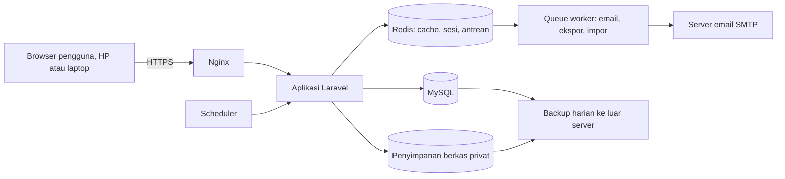

### 9.3 Susunan kode

Rute → middleware (login, wajib ganti password, permission) → controller/komponen → Form Request (validasi) → **Action/Service (aturan bisnis)** → model → Policy (otorisasi per objek) → event → listener (notifikasi, audit).

- Aturan bisnis (BR) hanya ditulis di lapisan Action/Service, tidak di controller atau tampilan.
- Action yang mengubah lebih dari satu tabel selalu memakai transaksi database.
- Kode dipisah per domain: Employee, Attendance, Leave, Approval, Task, Kpi, Report, Payroll, Recruitment.

### 9.4 Job terjadwal

Semua job harus aman dijalankan ulang (idempoten).

| Job | Jadwal | Fungsi | Fase |
|---|---|---|:-:|
| `attendance:close-day` | Tiap jam | Menutup hari bagi lokasi kerja yang baru melewati tengah malam: Alpa, lupa clock-out, sinkron cuti | F1 |
| `attendance:remind-clock-in` | Tiap 15 menit pada hari kerja | Mengirim N-10 bagi yang belum clock-in 30 menit setelah jam masuk | F1 |
| `employee:apply-scheduled-changes` | Harian 00.10 | Menjalankan penonaktifan terjadwal dan efek penempatan bertanggal | F1 |
| `employee:contract-reminders` | Harian 08.00 | Pengingat kontrak/masa percobaan | F1 |
| `leave:grant-annual` | Harian 00.20 | Membentuk saldo tahunan pada 1 Januari dan saat karyawan memenuhi syarat | F1 |
| `approval:remind` | Harian 08.00 pada hari kerja | Pengingat dan eskalasi approval | F1 |
| `exports:purge` | Harian | Menghapus berkas ekspor kedaluwarsa | F1 |
| `notifications:purge` | Mingguan | Menghapus notifikasi lebih dari 90 hari | F1 |
| `backup:run` | Harian 01.00 | Backup database dan berkas | F1 |
| `task:generate-recurring` | Tiap jam | Membuat task rutin hari ini dan menandai Terlewat untuk hari sebelumnya | F2 |
| `task:deadline-reminders` | Tiap jam | Pengingat tenggat dan penanda terlambat | F2 |
| `kpi:compute-auto` | Harian 02.00 | Menghitung indikator otomatis | F2 |
| `candidates:anonymize` | Bulanan | Menganonimkan kandidat melewati masa simpan | F3 |

### 9.5 Lingkungan

| Lingkungan | Kegunaan | Data |
|---|---|---|
| Lokal | Pengembangan | Data contoh dari seeder |
| Staging | UAT dan uji rilis | Data samaran, bukan salinan mentah produksi |
| Produksi | Pemakaian nyata | Data asli, backup otomatis |

Konfigurasi lewat variabel lingkungan; rahasia (kunci aplikasi, password database, SMTP) tidak masuk repositori.

---

## 10. Non-functional Requirements

Asumsi skala: sampai 200 karyawan dan 3 tahun data, kira-kira 190.000 baris absensi.

| ID | Kategori | Requirement dan target |
|---|---|---|
| NFR-SEC-01 | Keamanan | Seluruh akses lewat HTTPS; HTTP dialihkan; HSTS aktif |
| NFR-SEC-02 | Keamanan | Password di-*hash* dengan algoritma bawaan framework; tidak pernah tersimpan atau tercatat polos |
| NFR-SEC-03 | Keamanan | Proteksi CSRF di semua form; cookie sesi `Secure`, `HttpOnly`, `SameSite=Lax` |
| NFR-SEC-04 | Keamanan | Semua input divalidasi di server, keluaran di-*escape*, query lewat ORM/parameter |
| NFR-SEC-05 | Keamanan | Unggahan divalidasi ekstensi, MIME, dan ukurannya; nama berkas diacak; disimpan di luar web root |
| NFR-SEC-06 | Keamanan | Kolom sensitif terenkripsi; kunci aplikasi hanya di variabel lingkungan dan dicadangkan terpisah |
| NFR-SEC-07 | Keamanan | Pembatasan laju: login (FR-AUTH-05), lupa password 3 kali/jam per email, ekspor 10 kali/jam per pengguna |
| NFR-SEC-08 | Keamanan | Header keamanan dasar: `X-Content-Type-Options`, pembatasan *framing*, `Referrer-Policy`, Content-Security-Policy |
| NFR-SEC-09 | Keamanan | Akses server memakai kunci SSH; port database tidak terbuka ke internet |
| NFR-SEC-10 | Keamanan | Pembaruan keamanan dependensi minimal sebulan sekali |
| NFR-PRV-01 | Privasi | Data pribadi hanya bisa diakses role berwenang (bagian 6); akses data sensitif tercatat |
| NFR-PRV-02 | Privasi | Dokumen pribadi, lampiran cuti, CV, dan slip gaji tidak bisa diakses lewat URL publik |
| NFR-PRV-03 | Privasi | Pengelolaan data pribadi memperhatikan UU Pelindungan Data Pribadi (UU No. 27 Tahun 2022): tujuan jelas, akses terbatas, pengamanan, pencatatan |
| NFR-PRF-01 | Performa | Halaman daftar dan detail: p95 ≤ 1,5 detik |
| NFR-PRF-02 | Performa | Clock-in/out: respons ≤ 1 detik |
| NFR-PRF-03 | Performa | Dashboard: ≤ 2 detik |
| NFR-PRF-04 | Performa | Ekspor 10.000 baris selesai ≤ 60 detik di antrean |
| NFR-PRF-05 | Performa | Semua daftar berpaginasi (default 25 baris); tidak ada query N+1 pada halaman daftar |
| NFR-PRF-06 | Performa | 50 pengguna clock-in hampir bersamaan tanpa galat |
| NFR-REL-01 | Keandalan | Backup otomatis harian (database + berkas): 30 salinan harian dan 12 salinan bulanan, dengan salinan di luar server |
| NFR-REL-02 | Keandalan | RPO ≤ 24 jam, RTO ≤ 4 jam |
| NFR-REL-03 | Keandalan | Uji pemulihan dari backup sebelum go-live dan setiap 3 bulan |
| NFR-REL-04 | Keandalan | Ketersediaan ≥ 99% pada jam kerja; pemeliharaan terjadwal di luar jam kerja |
| NFR-REL-05 | Keandalan | Job gagal tercatat dan tampil di widget status sistem |
| NFR-CMP-01 | Kompatibilitas | Chrome, Edge, Firefox, Safari dua versi mayor terakhir; Chrome Android dan Safari iOS |
| NFR-CMP-02 | Kompatibilitas | Lebar layar minimum 360 px; halaman swalayan staff nyaman dipakai di HP |
| NFR-ACC-01 | Aksesibilitas | WCAG 2.1 AA untuk kontras, navigasi keyboard, dan label form (rinci di PRD Design) |
| NFR-MNT-01 | Pemeliharaan | Uji otomatis untuk semua aturan bisnis (BR) dan matriks permission; cakupan ≥ 70% pada lapisan Action/Service |
| NFR-MNT-02 | Pemeliharaan | CI menjalankan lint dan test di setiap perubahan; rilis hanya dari cabang utama yang lulus |
| NFR-MNT-03 | Pemeliharaan | Semua perubahan skema lewat migration; data awal lewat seeder; README instalasi dan operasional |
| NFR-MNT-04 | Pemeliharaan | Log aplikasi dirotasi harian, disimpan 14 hari, tanpa password dan data sensitif |
| NFR-MNT-05 | Pemeliharaan | Tersedia endpoint *health check* untuk pemantauan |
| NFR-LOC-01 | Lokalisasi | Antarmuka berbahasa Indonesia; teks disimpan di berkas bahasa agar bisa ditambah bahasa lain |
| NFR-LOC-02 | Lokalisasi | Format: tanggal `9 Okt 2026`, jam 24 jam `08:05`, angka `1.234,5`, mata uang `Rp1.234.000` |
| NFR-LOC-03 | Lokalisasi | Server dan database memakai UTC; tampilan memakai zona waktu lokasi kerja, dan zona waktu ditulis jelas bila pengguna dan pemilik data berbeda zona |

---

## 11. Rencana Implementasi (Task Breakdown)

**Ukuran** adalah perkiraan kompleksitas untuk satu developer, bukan komitmen jadwal: **S** ≤ 1 hari, **M** 2–3 hari, **L** 4–5 hari.

**Definition of Done umum** (berlaku untuk setiap task, selain kolom "Selesai bila"):

1. Lulus lint dan test; ada uji otomatis untuk aturan bisnis dan izin yang disentuh.
2. Otorisasi ditegakkan di backend, bukan hanya di tampilan.
3. Tampilan mengikuti PRD Design (token, komponen, keadaan kosong/memuat/galat) dan sudah dicoba di layar HP.
4. Peristiwa penting masuk audit log dan notifikasi terkait terkirim.
5. Migration, seeder, dan dokumentasi singkat diperbarui.
6. Acceptance criteria terkait dicentang di staging.

### Fase 0 — Persiapan dan keputusan

| ID | Task | Rincian pekerjaan | Selesai bila | Bergantung | Ukuran |
|---|---|---|---|---|:-:|
| T0.01 | Menetapkan keputusan bisnis | Memutuskan K-01 s.d. K-12, minimal yang bertanda ⚠️ untuk F1 (K-02, K-04, K-05) | Tabel keputusan terisi dan disetujui | – | S |
| T0.02 | Mengumpulkan data master | Mengisi template Excel: data karyawan (departemen, jabatan, atasan, tanggal bergabung, status kerja), saldo cuti awal, hari libur tahun berjalan | Berkas lengkap, kolom wajib tidak ada yang kosong | T0.01 | M |
| T0.03 | Menyiapkan infrastruktur | VPS, domain/subdomain, SSL, akun SMTP, lokasi backup di luar server, repositori kode | Server bisa diakses lewat HTTPS; kredensial tersimpan aman | – | S |
| T0.04 | Menyetujui PRD Design | Meninjau token, layout, dan wireframe halaman F1 | Desain F1 disetujui, catatan revisi tuntas | – | S |

### Phase 1 — Foundation

| ID | Task | Rincian Pekerjaan | Kriteria Selesai | Bergantung | Ukuran |
|---|---|---|---|---|:-:|
| T1.01 | Setup Basis Monorepo & Lingkungan | Konfigurasi Laravel 10 backend + React TypeScript Vite frontend, database `hris_db`, koneksi database & environment | Backend dan frontend terhubung lancar | – | M |
| T1.02 | Master Data Organisasi Kurma Group | Migrasi dan seeder untuk 4 departemen: Herbal, Fashion MY PH, Shopee Video, HR Department serta jabatan-jabatan terkait | Departemen & jabatan tersimpan di database secara dinamis | T1.01 | M |
| T1.03 | Autentikasi & Granular RBAC | Sanctum API auth, Spatie permission catalog (swalayan vs manajemen), middleware otorisasi, data scoping | Uji izin granular lulus di backend | T1.02 | M |
| T1.04 | Dual-Portal App Shell Layout | Layout terpisah di frontend: **User Portal** dan **Management Backend**, dengan portal switcher berdasarkan role pengguna | User & Admin memiliki sidebar & navigasi terpisah yang bersih | T1.03 | L |
| T1.05 | Infrastruktur Audit Trail & Storage | Pencatatan otomatis ke `audit_logs`, penyimpanan privat berkas lampiran | Perubahan sensitif tercatat dengan IP dan actor | T1.03 | M |

### Phase 2 — User Portal

| ID | Task | Rincian Pekerjaan | Kriteria Selesai | Bergantung | Ukuran |
|---|---|---|---|---|:-:|
| T2.01 | Dashboard Pribadi Karyawan | Sapaan, status absensi hari ini, tombol Scan QR, status Daily Report hari ini, ringkasan izin terakhir, notifikasi | Dashboard menampilkan data pengguna login secara akurat | T1.04 | M |
| T2.02 | Profil Karyawan & Edit Mandiri | Tampilan profil lengkap, kemampuan edit terbatas (foto, kontak), perlindungan kolom sensitif | Karyawan hanya bisa mengubah field yang diizinkan | T1.04 | M |
| T2.03 | Dynamic QR Attendance Scanner | Antarmuka kamera scanner di browser/HP, integrasi kirim token ke server, validasi waktu server & anti-double-scan | Scan QR sukses mencatat clock-in/out dengan respons seketika | T1.03 | L |
| T2.04 | Pengajuan Izin & Cuti | Form izin/cuti, validasi durasi & tanggal, unggah surat keterangan dokter, daftar status pengajuan pribadi | Pengajuan tersimpan dengan status pending dan menunggu approval | T1.05 | M |
| T2.05 | **Daily Report Spreadsheet Interaktif** | Grid tabel spreadsheet (No, Waktu Mulai, Waktu Selesai, Aktivitas, Hasil, Status, Catatan), inline edit, shortcut keyboard, autosave & draft, tombol kirim laporan | Pengalaman spreadsheet bekerja mulus, validasi waktu konsisten | T1.04 | L |
| T2.06 | Riwayat & Notifikasi Personal | Riwayat kehadiran, pengajuan izin, dan histori laporan harian, panel notifikasi status | Pengguna dapat melihat arsip aktivitas dan revisi | T2.05 | M |

### Phase 3 — Management Backend

| ID | Task | Rincian Pekerjaan | Kriteria Selesai | Bergantung | Ukuran |
|---|---|---|---|---|:-:|
| T3.01 | Dashboard Manajemen Live | Metrik aktual: total karyawan aktif per departemen, rekap absensi hari ini, pengajuan pending, daily report butuh review (tanpa data dummy) | Menampilkan ringkasan operasional real-time | T1.04 | M |
| T3.02 | Employee Management & Mutasi | CRUD karyawan, penempatan departemen & manager, riwayat penempatan/mutasi tanpa menghapus histori, dokumen pribadi | Data histori mutasi tersimpan rapi | T1.02 | L |
| T3.03 | Attendance Management & QR Screen | Monitoring kehadiran tim/perusahaan, rekap keterlambatan, **Dynamic QR Code Screen** untuk display kantor | Layar display menghasilkan QR baru secara periodik | T2.03 | L |
| T3.04 | Approval Management Terpadu | Halaman persetujuan untuk pengajuan izin/cuti dan koreksi absensi dengan alur Manager → HR | Approver dapat menyetujui atau menolak dengan catatan | T2.04 | M |
| T3.05 | **Daily Report Review Management** | Antarmuka manager untuk melihat laporan harian tim, tabel detail aktivitas, tombol **Terima Laporan** dan **Minta Revisi** dengan catatan, rekap produktivitas, ekspor Excel | Workflow revisi berfungsi dua arah antara staff dan manager | T2.05 | L |

### Phase 4 — Performance and Payroll

| ID | Task | Rincian Pekerjaan | Kriteria Selesai | Bergantung | Ukuran |
|---|---|---|---|---|:-:|
| T4.01 | KPI Management Berbasis Jabatan | Template indikator KPI per jabatan (Marketing, Riset, Copywriter, IT, HR, Finance, dll.), bobot target, pengisian realisasi | Perhitungan skor KPI transparan dan tersimpan | T3.02 | L |
| T4.02 | Payroll Management (Isolasi Privasi) | Penggajian bulanan, perhitungan hari hadir, komponen pendapatan/potongan tipe desimal, kontrol akses ketat (Manager tidak melihat gaji tim, Staff hanya melihat slip sendiri) | Hak akses payroll terisolasi 100% | T3.03 | L |
| T4.03 | Slip Gaji Digital & Riwayat | Penerbitan slip gaji privat per karyawan, pratinjau dan unduh PDF | Karyawan hanya bisa membuka slip miliknya | T4.02 | M |
| T4.04 | Laporan Manajemen & Ekspor | Rekap kehadiran, produktivitas harian, dan evaluasi dalam format Excel dan PDF | Ekspor data berfungsi sesuai cakupan akses role | T3.05 | M |

### Phase 5 — Quality Assurance & Security

| ID | Task | Rincian Pekerjaan | Kriteria Selesai | Bergantung | Ukuran |
|---|---|---|---|---|:-:|
| T5.01 | Pengujian Otorisasi & RBAC Granular | Pengujian seluruh rute endpoint API terhadap akses lintas-departemen dan privilege escalation | 0 akses tidak sah yang lolos | T4.02 | M |
| T5.02 | Pengujian Keamanan Dynamic QR | Pengujian pencegahan scan ganda, pengujian token kedaluwarsa, dan pencegahan manipulasi client-side | Token tidak bisa direplay atau dipakai ganda | T2.03 | M |
| T5.03 | Pengujian Alur Daily Report & Revisi | Uji pengisian draft, autosave, submit, feedback revisi, dan finalisasi accepted | Siklus revisi berjalan tanpa bug | T3.05 | M |
| T5.04 | Verifikasi Audit Trail & Backup | Memastikan seluruh aksi penting (approval, mutasi karyawan, perubahan payroll) tercatat di audit log | Riwayat perubahan tercatat lengkap | T1.05 | S |
| T6.07 | Konversi kandidat | Kandidat Diterima menjadi form karyawan terisi (FR-REC-05) | AC-REC-01 | T6.06 | S |
| T6.08 | Checklist on/offboarding | Template, pembentukan otomatis, tampilan penanggung jawab, progres (FR-REC-06–08) | AC-REC-02, AC-REC-04 | T6.06 | L |
| T6.09 | Laporan dan retensi kandidat | Laporan rekrutmen, job anonimisasi (FR-REC-09, 10) | Kandidat lama teranonimkan pada data uji | T6.08 | S |
| T6.10 | Audit keamanan dan rilis F3 | Uji akses payroll menyeluruh, UAT F3, pelatihan HR dan Finance | Skenario F3 lulus; tidak ada akses nominal oleh role tak berwenang | T6.05, T6.09 | M |

### Backlog opsional (belum dijadwalkan)

Requirement berprioritas **O** dikerjakan setelah fase terkait stabil, sesuai kebutuhan:

| Requirement | Isi |
|---|---|
| FR-AUTH-11 | Keluar dari semua perangkat |
| FR-ATT-17 | Pembatasan clock-in berdasarkan IP kantor |
| FR-APR-11 | Setujui massal |
| FR-APR-12 | Editor alur approval kustom |
| FR-KPI-15 | Membuka kembali periode KPI yang sudah ditutup |

### Perkiraan ukuran dan urutan kritis

Dengan nilai tengah S = 1, M = 2,5, dan L = 4,5 hari kerja:

| Fase | Jumlah task | Perkiraan hari kerja (satu developer) |
|---|:-:|:-:|
| Fase 0 — Persiapan | 4 | 5,5 (sebagian besar pekerjaan HR/manajemen) |
| Fase 1 — Fondasi | 12 | 27,5 |
| Fase 2 — Employee Management | 9 | 27 |
| Fase 3 — Absensi dan Cuti | 13 | 39 |
| Fase 4 — Dashboard, Laporan, Rilis MVP | 10 | 27,5 |
| **Total sampai MVP** | **48** | **± 126,5** |
| Fase 5 — Task dan KPI | 14 | 43,5 |
| Fase 6 — Payroll, Rekrutmen, On/Offboarding | 10 | 28,5 |

Angka ini perkiraan kasar untuk menimbang lingkup, bukan jadwal. Dikerjakan satu developer secara berurutan, MVP berarti sekitar 25 minggu kerja. Dengan dua developer yang bekerja paralel, paling cepat sekitar 13 minggu. Menambah developer ketiga tidak banyak mempercepat, karena rantai dependensi terpanjang sendiri sudah ± 59 hari kerja (sekitar 12 minggu).

**Rantai dependensi terpanjang menuju rilis MVP:** T0.03 → T1.01 → T1.03 → T1.04 → T1.05 → T1.07 → T2.01 → T2.02 → T2.04 → T2.05 → T2.06 → T3.05 → T3.10 → T3.11 → T4.01 → T4.02 → T4.06 → T4.08 → T4.09 → T4.10.

Task di luar rantai ini (mis. impor, laporan, notifikasi, kalender cuti) bisa dikerjakan paralel bila ada lebih dari satu developer. T0.02 (data master) sebaiknya dimulai sejak awal: pengumpulannya biasanya paling lama dan hasilnya menentukan T4.07.

---

## 12. Rencana Pengujian dan UAT

### 12.1 Lapisan pengujian

| Lapisan | Yang diuji | Alat | Kapan |
|---|---|---|---|
| Unit | Aturan bisnis: status absensi, hitung hari cuti, saldo, resolusi approver, mesin status tugas, rumus KPI | Pest/PHPUnit | Setiap perubahan (CI) |
| Feature | Rute, izin, validasi, dan efeknya ke database; matriks role × rute | Pest/PHPUnit | Setiap perubahan (CI) |
| End-to-end | Alur utama lewat browser: login, clock-in, ajukan lalu setujui cuti, koreksi, ekspor | Playwright | Sebelum rilis |
| Performa | Target NFR-PRF dengan data uji | Skrip beban sederhana | Sebelum rilis tiap fase |
| Keamanan | Akses lintas cakupan lewat ID di URL, unggahan, pembatasan laju, header | Manual + otomatis | Sebelum rilis tiap fase |
| UAT | Skenario 12.3 oleh pengguna sebenarnya | Manual di staging | Sebelum rilis tiap fase |

### 12.2 Uji matriks role (wajib)

Data uji minimal: 2 departemen yang masing-masing punya 1 manager dan 2 staff, ditambah 1 HR Admin, 1 Finance, 1 Operations Manager, 1 Management Viewer, 1 System Admin. Untuk setiap rute dan aksi, uji otomatis memastikan:

- Staff A tidak bisa melihat atau mengubah data Staff B.
- Manager departemen 1 tidak bisa melihat, memutuskan, atau mengekspor data departemen 2.
- Role tanpa permission mendapat 403, bukan halaman kosong.
- Tidak ada yang bisa memutuskan pengajuan miliknya sendiri.
- Field sensitif tidak ikut terkirim ke role yang tidak berhak, termasuk di ekspor.

### 12.3 Skenario UAT

| ID | Skenario | Pelaku | Hasil yang diharapkan | Fase |
|---|---|---|---|:-:|
| UAT-01 | HR menambah karyawan baru sampai akunnya bisa login | HR, karyawan baru | Karyawan login, wajib ganti password, lalu melihat dashboard staff | F1 |
| UAT-02 | Clock-in tepat waktu lalu clock-out | Staff | Status Hadir dan durasi kerja terhitung | F1 |
| UAT-03 | Clock-in terlambat | Staff, Manager | Status Terlambat dengan menit yang benar; tampil di dashboard manager | F1 |
| UAT-04 | Lupa clock-out, mengajukan koreksi, manager menyetujui | Staff, Manager | Notifikasi lupa clock-out; setelah disetujui record lengkap dan tercatat di audit log | F1 |
| UAT-05 | Tidak absen pada hari kerja | Staff | Keesokan harinya berstatus Alpa | F1 |
| UAT-06 | Cuti Tahunan 2 hari: diajukan, disetujui manager, divalidasi HR | Staff, Manager, HR | Saldo berkurang 2; kalender dan absensi terisi; notifikasi di tiap tahap | F1 |
| UAT-07 | Manager menolak pengajuan izin | Staff, Manager | Alasan wajib diisi dan terlihat oleh pemohon; saldo tidak berubah | F1 |
| UAT-08 | Membatalkan cuti yang sudah disetujui sebelum tanggal mulai | Staff | Saldo kembali; absensi kembali normal; atasan dan HR diberi tahu | F1 |
| UAT-09 | Pengajuan melebihi saldo, lalu pengajuan bentrok tanggal | Staff | Keduanya ditolak saat dikirim dengan pesan yang jelas | F1 |
| UAT-10 | Manager mengajukan cuti | Manager, Kepala HR | Pengajuan jatuh ke approver cadangan, bukan ke dirinya sendiri | F1 |
| UAT-11 | Manager menunjuk pengganti, lalu ada pengajuan masuk | Manager, pengganti, Staff | Pengganti memutuskan; linimasa mencatat "atas nama" | F1 |
| UAT-12 | HR memutasi staff ke departemen lain | HR, kedua Manager | Histori tersimpan; manager lama tidak lagi melihat, manager baru melihat | F1 |
| UAT-13 | HR menonaktifkan karyawan | HR, karyawan | Tidak bisa login; data lamanya tetap ada di laporan | F1 |
| UAT-14 | Staff membuka profil atau absensi karyawan lain lewat URL | Staff | Ditolak (403) | F1 |
| UAT-15 | HR mengunci periode, lalu staff mencoba koreksi di bulan itu | HR, Staff | Koreksi ditolak | F1 |
| UAT-16 | HR mengekspor rekap absensi bulanan ke Excel dan PDF | HR | Berkas sesuai filter, PDF berkop, ekspor tercatat di audit log | F1 |
| UAT-17 | Manager mengekspor rekap tim | Manager | Berkas hanya berisi timnya | F1 |
| UAT-18 | Admin mengubah role seorang pengguna | Admin, pengguna | Menu dan izin berubah pada request berikutnya; perubahan tercatat | F1 |
| UAT-19 | Impor 20 karyawan dari Excel dengan 2 baris salah | HR | 18 karyawan masuk; laporan memuat 2 error | F1 |
| UAT-20 | Seluruh alur staff dijalankan dari HP | Staff | Semua langkah bisa dilakukan tanpa menggeser layar ke samping | F1 |
| UAT-21 | Tugas: diberi, dikerjakan, dikirim dengan bukti, diminta revisi, disetujui | Manager, Staff | Status dan riwayat benar; notifikasi di tiap langkah | F2 |
| UAT-22 | Checklist harian tercipta, dicentang, dan satu hari terlewat | Staff, Manager | Rekap kepatuhan benar; status Terlewat muncul | F2 |
| UAT-23 | Satu siklus KPI mingguan dari pembuatan periode sampai penutupan | HR, Manager, Staff | Skor dan grade sesuai rumus; staff melihat hasil dan menanggapi | F2 |
| UAT-24 | Manager Operasional memberi tugas ke departemen lain | Ops, Staff, Manager staff | Tugas diterima; manager dari staff ikut melihatnya | F2 |
| UAT-25 | Satu siklus payroll dari periode sampai slip | HR/Finance, penyetuju, Staff | Uang makan sesuai hari hadir; slip hanya bisa dibuka pemiliknya | F3 |
| UAT-26 | Kandidat diterima, menjadi karyawan, checklist onboarding berjalan | HR, Manager, IT | Data tidak diketik ulang; item checklist muncul di tiap penanggung jawab | F3 |

---

## 13. Kriteria Rilis

### 13.1 Rilis MVP (F1)

- [ ] Semua acceptance criteria modul F1 (AUTH, ORG, EMP, ATT, LEV, APR, DSH, RPT, NTF, SET) tercentang.
- [ ] UAT-01 s.d. UAT-20 lulus.
- [ ] Uji matriks role lulus tanpa temuan akses lintas cakupan.
- [ ] Target performa dan keamanan pada bagian 10 terpenuhi dengan data uji.
- [ ] Backup otomatis berjalan dan uji pemulihan berhasil.
- [ ] Data awal termigrasi dan diverifikasi HR (jumlah karyawan, atasan, saldo cuti, hari libur).
- [ ] Semua karyawan punya akun; panduan dan pelatihan per role selesai.
- [ ] K-01 s.d. K-07, K-09, K-11, dan K-12 sudah final dan tercermin di Pengaturan.
- [ ] Rencana kembali ke kondisi sebelum rilis (rollback) tertulis.

### 13.2 Rilis F2 dan F3

- [ ] **F2:** semua AC modul TSK dan KPI tercentang; UAT-21 s.d. UAT-24 lulus; K-08 final; template KPI disetujui manajemen.
- [ ] **F3:** semua AC modul PAY dan REC tercentang; UAT-25 dan UAT-26 lulus; K-10 dan kebijakan payroll final; audit akses payroll tanpa temuan.

### 13.3 Jejak kriteria v1

Sepuluh acceptance criteria pada v1 tetap berlaku dan kini diuji lewat:

| Kriteria v1 | Diuji lewat |
|---|---|
| Admin dapat membuat departemen, jabatan, akun, dan permission | AC-ORG-01, AC-AUTH-01, AC-SET-02 |
| Keempat kelompok departemen dikelola dalam satu sistem | AC-ORG-01 |
| Manager hanya melihat dan mengelola data timnya | AC-EMP-03, AC-ATT-10, UAT-12, UAT-17 |
| Staff melihat profil pribadi serta absensi dan pengajuan miliknya | AC-EMP-04, UAT-02, UAT-06, UAT-14 |
| Cuti dan koreksi absensi punya alur persetujuan dan riwayat keputusan | AC-LEV-05, AC-ATT-06, AC-APR-01 s.d. AC-APR-07 |
| Karyawan nonaktif tidak bisa login, histori tetap tersimpan | AC-EMP-06, AC-AUTH-03 |
| Dashboard dan laporan menampilkan data sesuai permission | AC-DSH-02, AC-RPT-02 |
| Data sensitif, terutama penggajian, tidak bisa diakses role tidak berwenang | AC-EMP-05, AC-PAY-03, AC-PAY-06 |
| Perubahan penting tercatat di audit log | AC-SET-03, AC-SET-04, AC-ATT-06 |
| Aplikasi dapat dijalankan lewat Docker | T1.01 |

---

## 14. Risiko dan Mitigasi

| # | Risiko | Dampak | Mitigasi |
|--:|---|---|---|
| 1 | Keputusan bisnis terlambat ditetapkan | Aturan dikerjakan ulang | Default di bagian 4; sebagian besar berupa pengaturan; K bertanda ⚠️ diputuskan di Fase 0 |
| 2 | Titip absen atau absen dari luar kantor, karena absensi memakai tombol | Data kehadiran kurang dipercaya | Pencatatan IP dan perangkat; opsi pembatasan IP kantor (FR-ATT-17); tinjau pola ganjil lewat R-03; siapkan GPS/foto bila perlu |
| 3 | Data awal tidak rapi (atasan kosong, tanggal salah) | Approval salah alamat, saldo salah | Template dan pratinjau impor; notifikasi N-15; verifikasi HR pada T4.07 |
| 4 | Adopsi rendah, pengajuan tetap lewat chat | Data tidak lengkap | Alur staff ringkas di HP; pelatihan; penetapan tanggal mulai "pengajuan hanya sah lewat sistem"; pengingat |
| 5 | Kebocoran data sensitif | Pelanggaran privasi | Enkripsi kolom, permission terpisah, penyimpanan privat, audit akses, uji matriks role |
| 6 | Kesalahan zona waktu | Tanggal kerja atau status terlambat keliru | Simpan UTC, tanggal kerja per lokasi, uji khusus AC-ATT-08 |
| 7 | Server tunggal rusak | Sistem berhenti, data hilang | Backup harian ke luar server, uji pemulihan berkala, prosedur tertulis |
| 8 | Lingkup payroll melebar | Rilis MVP tertunda | Payroll dipisah ke F3; pajak dan BPJS diinput manual |
| 9 | KPI dirasa tidak adil | Penolakan dari karyawan | Indikator kualitas wajib, batas bobot indikator otomatis, staff melihat rumus dan bisa menanggapi, template disepakati manajemen |
| 10 | Bergantung pada satu approver | Pengajuan menumpuk | Delegasi, pengalihan oleh HR, pengingat dan eskalasi |
| 11 | Email tidak terkirim | Approver tidak tahu ada pengajuan | Notifikasi dalam aplikasi sebagai kanal utama; antrean dengan percobaan ulang; widget "menunggu keputusan saya" |

---

## 15. Glosarium

| Istilah | Arti |
|---|---|
| Alpa | Tidak hadir pada hari kerja tanpa cuti/izin yang disetujui |
| Approver cadangan | Orang yang memutuskan bila atasan langsung tidak ada (default: Kepala HR) |
| Approver puncak | Orang yang memutuskan pengajuan milik approver cadangan |
| Atasan langsung | Karyawan yang tercatat sebagai atasan pada penempatan aktif |
| Cakupan data | Batas data yang boleh dilihat: `own`, `team`, `all` |
| Delegasi | Penunjukan pengganti approver untuk rentang tanggal tertentu |
| Kunci periode | Pembekuan data absensi satu bulan agar tidak berubah lagi |
| Lembar KPI | Kumpulan indikator satu karyawan pada satu periode penilaian |
| Penempatan | Baris histori berisi departemen, jabatan, dan atasan dengan tanggal efektif |
| PIC | Penanggung jawab utama sebuah tugas |
| RBAC | Pengaturan hak akses berbasis role |
| RPO / RTO | Batas kehilangan data yang bisa diterima / batas lama pemulihan sistem |
| Swalayan | Fitur yang dipakai karyawan untuk datanya sendiri |
| Tanggal kerja | Tanggal kalender menurut zona waktu lokasi kerja karyawan |
| Task rutin | Tugas berbentuk checklist yang dibuat otomatis pada tiap hari kerja |
| Tutup hari | Job yang memfinalkan absensi hari sebelumnya |
